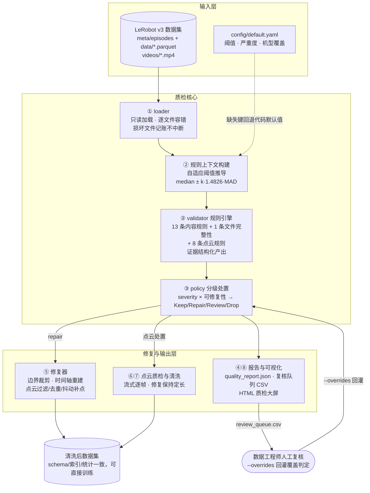
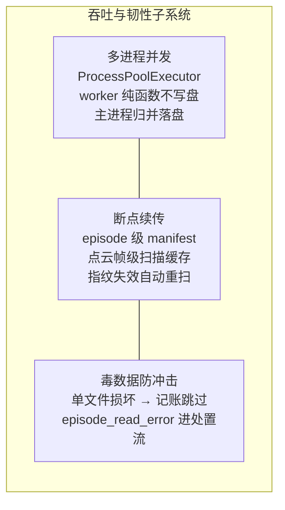

# 架构设计说明书

**项目**：机器人多模态数据质量治理流水线（LeRobot v3 / 视频 + 动作序列 + 3D 点云）
**读者**：具身智能方向技术负责人
**定位**：本文是与行业专家交流用的架构说明，聚焦设计决策与其背后的权衡，不涉及使用手册（见 README）。

---

## 1. 项目定位与业务痛点

### 1.1 一句话定位

在「原始采集数据」与「训练管线」之间补一层**数据质量治理层**：对 LeRobot v3 数据集做质检 → 分级处置 → 自动修复 → 留痕报告的一站式流水线。只做数据质量工程，不碰训练代码。

### 1.2 为什么不能「有异常就删」

机器人模仿学习的数据有三个业务现实：

1. **采集成本极高**。遥操作采集一条 episode 是分钟级的人力投入，且真实产线/实验室的异常几乎必然发生：控制环丢包产生 NaN、采集中断写坏 parquet、镜头被遮挡、合并批次时重复入库。
2. **坏数据的破坏方式是静默的**。一段 112 帧里混 11 帧 NaN 的 episode 会让训练直接崩溃；视频与 state 差 2 帧，训练管线不会报错——它会**安静地学到错位数据**，代价在几周后的评测才暴露。
3. **大多数异常是可救的**。NaN 只出现在首尾可以裁剪；时间轴错乱可以用 `frame_index/fps` 重建；点云稀疏帧可以按分布补点；meta 索引漂移可以按真实行数重算。

因此本系统的核心动作不是「过滤」，而是**分级处置（Keep / Repair / Review / Drop）**：

| 级别 | 语义 | 业务含义 |
|---|---|---|
| Keep | 通过全部规则 | 直接入库 |
| Repair | 命中可自动修复的异常 | 系统修复并记录修复动作清单，保留数据资产 |
| Review | 规则无法裁决（如 action 跳变可能是真实操作） | 导出复核队列转人工，结论可回灌覆盖系统判定 |
| Drop | 不可修复的硬损坏 | 剔除，并在报告中保留证据链 |

在演示数据集（36 条 episode，注入 13 处典型异常）上的实测分布是：**保留 24 / 修复 2 / 复核 2 / 剔除 8**——如果采用「有异常就删」，被删的 13 条里有 4 条本可以回到训练集。在数据稀缺、采集昂贵的具身智能领域，这个差值直接就是模型性能。

### 1.3 质检结论必须可被推翻

自动判定不享有最终裁决权：所有 review/drop 结论导出为带证据（视频路径、时间窗、量化指标）的复核队列 CSV，数据工程师填写后通过 `--overrides` 回灌，覆盖系统判定并全程留痕。这是数据治理与一次性清洗脚本的分水岭。

---

## 2. 核心架构

### 2.1 数据流转图



### 2.2 关键工程子系统



三个子系统的实测指标（50 episode / 18374 帧真实数据集）：

| 能力 | 机制 | 实测 |
|---|---|---|
| 并发吞吐 | episode 按条并行、点云按 (文件, row group) 分片并行，结论与串行**逐位一致** | 190.1s → 64.7s（workers=8，2.9×） |
| 断点续传 | 无变化整体短路 35.3s → 1.6s；强制重检时点云缓存命中（27s → 0s） | 修复坏文件后仅该分片自动重扫 |
| 容错 | 人工损坏一个分片：23 个受影响 episode 标记 `episode_read_error` 剔除，其余 27 条正常流转，流水线不中断 | 全程无异常退出 |

**并发写入安全（评审高频问题）**：既没用「临时文件+合并」，也没用锁或 `Manager().Queue()`——而是**在设计上让冲突不存在**。worker 是纯函数：只读输入、返回可 pickle 结果，从不写盘；结果经 `Future`（本身线程安全）回传主进程，由主进程归并后统一写 JSON/CSV/parquet。计算与落盘在时间上也分离：`--workers` 只作用于质检阶段（②⑥），清洗写盘（⑤⑦）在质检完成后于主进程单线程执行。契约全文见 `pipeline/parallel.py` 模块 docstring。

---

## 3. 设计亮点

### 3.1 契约思维：修复后的数据满足「形状不变式」

修复器的第一原则不是「把数据改对」，而是**「修复产物必须满足下游训练管线的全部隐含契约」**：

- **定长契约**：点云修复（过滤 NaN → 去重 → 越界裁剪 → 颜色截断）会减少点数，修复器随后按场景尺度做抖动重采样**补回声明的固定点数**（如 512）。下游 DataLoader 看到的仍是形状整齐的 `[N, D]` 批次，不需要为清洗产物写任何分支逻辑。
- **索引契约**：episode 边界裁剪后，全局 `index` 连续性、`meta/episodes` 的 length、`dataset_from/to_index` 全部按真实行数重建——LeRobot 工具链的任何消费者都感知不到修复发生过。
- **schema 契约**：清洗用同 schema 的 ParquetWriter 原地重写，视频/任务/统计文件的引用关系保持不变。
- **可验证契约**：清洗末尾有独立的 `_verify` 步骤回读产物校验行数与特征列，验证失败只告警不静默通过。

这条不变式的价值在于：**数据治理层可以自由演进，训练层零耦合**。这是「契约」而非「约定」——它被校验步骤强制执行，而不是靠文档呼吁。

### 3.2 为什么用规则而不是 ML：确定性与算力成本的平衡

面对「数据质量」这个题目，第一个直觉往往是上模型。我们选择规则引擎，基于三点判断：

1. **这一层的问题是工程问题，不是语义问题**。NaN、帧错位、分布漂移、容器截断，都有精确的定义和可复现的判据。规则引擎给出的是**确定性结论**：同一份数据 + 同一份配置 = 逐位一致的报告（有并发一致性测试钉死这一点）。确定性是审计、diff、追责的前提。
2. **算力成本差三个数量级**。规则引擎纯 CPU、零 GPU 依赖，18374 帧多模态数据（含 512 点 × 6 维点云）全量质检在分钟级完成，可以进每次采集后的日常流程；ML 方案的推理成本决定了它只能是抽检。
3. **没有冷启动问题**。绝对阈值（如「点数 < 5000 就删」）在不同机器人上必然误报——关节量程、点云密度、采样率都不同。本系统的阈值是**自适应推导**的：帧数区间 = `median ± k·1.4826·MAD`，action 跳变阈值按维度取 `median(每集最大|Δ|) + k·MAD(每集最大|Δ|)`，点云离群半径 = `k × 1-NN 距离中位数`。配置里的固定值只是安全边界，不是主判据。换机器人零改动。

**边界是清醒的**：规则管「数据是否健全」，管不了「这段操作是否成功/有价值」——后者是语义判断，属于 ML 的领地。系统为此预留了明确的接合点（见 §4），两层各管各的。

### 3.3 证据结构化：每条结论都是可审计对象

规则不返回布尔值，而是返回结构化证据（`res.add(code, **evidence)`）：量化指标、触发阈值、推导依据、受影响帧号。报告因此可以携带数据集指纹、配置快照与自适应阈值的推导过程，两次运行的报告可以机械 diff。质检从「脚本输出一段日志」升级为「可审计的工程产物」。

---

## 4. 扩展性设计

### 4.1 规则即插件

新增一条规则的完整路径是注册表式的：在 `RULES` 表登记代码/标签/严重度 → 在 `rules.py` 写检查函数产出证据 → 在配置里加默认值与严重度 → 在 `policy.py` 声明可修复性。规则的全局统计依赖（如指纹预计算）收敛在 `DatasetContext.build`，流式与并行执行路径自动继承，不需要为每个新规则重写调度逻辑。

### 4.2 配置分层：真实业务数据的接入口

```text
代码内置 DEFAULT_CONFIG  ←  config.yaml  ←  robots[robot_type]  ←  CLI 显式覆盖
```

接入一家真实业务方的数据 = 在 YAML 的 `robots:` 下加一段覆盖（关节限位、action 量程、工作空间包围盒、严重度偏好）。未覆盖的键逐层回退默认值，业务方的配置文件只需要写「与默认不同」的几行。YAML 模板与代码默认值之间有测试强制逐位一致，杜绝配置与实现双源漂移。

### 4.3 ML 能力的三条预留通道

系统不内置 ML，但为 ML 能力预留了契约清晰的接合点，接入时**不需要改动流水线内部**：

1. **复核队列契约（推荐）**：`review_queue.csv` → `--overrides` 回灌是人机回路，同样也是机机回路——一个 ML 打分器（如「操作成功率模型」）只需输出同构 CSV 即可作为"自动 reviewer"接入，与人工复核共用同一条审计留痕通道。
2. **规则注册表**：ML 推理结果可以实现为一条新规则（如 `ml_semantic_fail`），走标准的证据结构/严重度/处置配置，自动获得并发、增量、报告能力。
3. **报告产物**：`quality_report.json` 的逐 episode 证据结构可作为 ML 训练的特征源——规则引擎为语义模型生产标注级输入，形成「规则兜底工程层、ML 覆盖语义层」的分工。

### 4.4 面向规模的执行模型

- **流式模式**按 parquet 分片两遍扫描，不把全量逐帧表读进内存；
- 视频探针优先读容器元数据（nb_frames / duration×fps），必要时才精确解码，几十 GB 视频集上避免全解码；
- 断点续传的两级缓存（episode 级 manifest + 点云帧级缓存）均以「文件指纹 + 配置指纹」为命中条件，数据修复、新增、配置变更都会精确触发最小范围重算。

---

## 5. 设计取舍与开放问题（向专家请教点）

坦诚记录当前的取舍，也是希望请教的方向：

1. **自适应阈值依赖数据集整体分布**。median/MAD 在 50+ episode 上稳定，但极小批次（<10 条）时退化为安全边界判据。是否需要引入跨批次的阈值记忆（历史分布先验）？
2. **点云时序一致性目前只用质心/包围盒尺度**，未做点云配准级的对齐。在动态场景中是否足够，业界有更好的低开销实践吗？
3. **视频内容检测只覆盖黑屏/遮挡**（抽帧灰度方差）。「操作是否成功」的语义判定明确留给 ML，但规则与 ML 结论冲突时的仲裁机制（谁优先、如何留痕）希望听取经验。
4. **修复动作的边界**：当前修复仅限不改变语义的机械操作（裁剪、重建、补点）。是否值得引入「修复可信度」评分，让下游训练按可信度加权而非二值取舍？

---

## 6. 质量保障基线

- 59 个单元/集成测试，覆盖串行/并行一致性、断点续传逐位一致、容错注入、配置回退；
- 并发结果与串行**逐位一致**（future 完成顺序不确定，归并后按键排序重建）；
- 报告含数据集内容哈希 + 配置快照 + 自适应阈值推导依据，历次运行可 diff；
- 全流程容错：任意单点文件损坏不产生中断，只产生带证据的处置结论。

*附：本文所有性能数字均来自真实数据集（50 episode / 18374 帧 / 169MB）实测，测试与复现方式见仓库 tests/ 与 README。*
