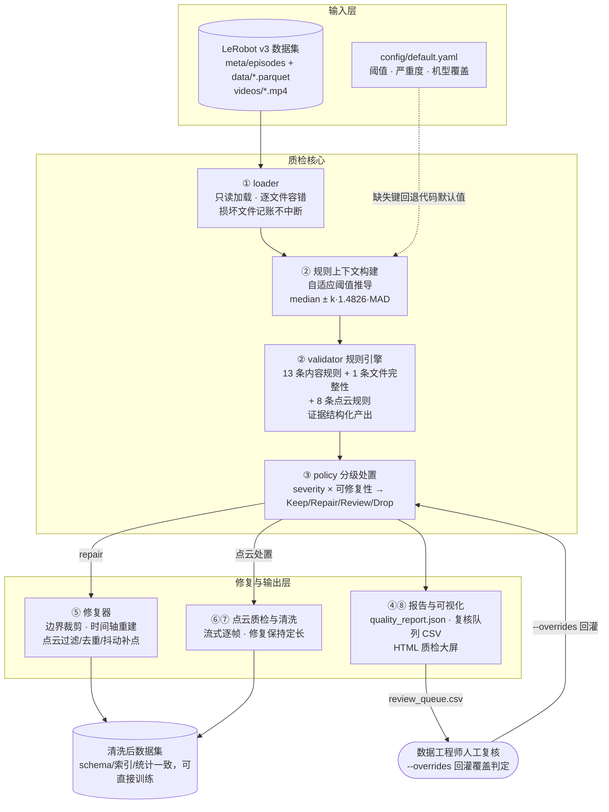
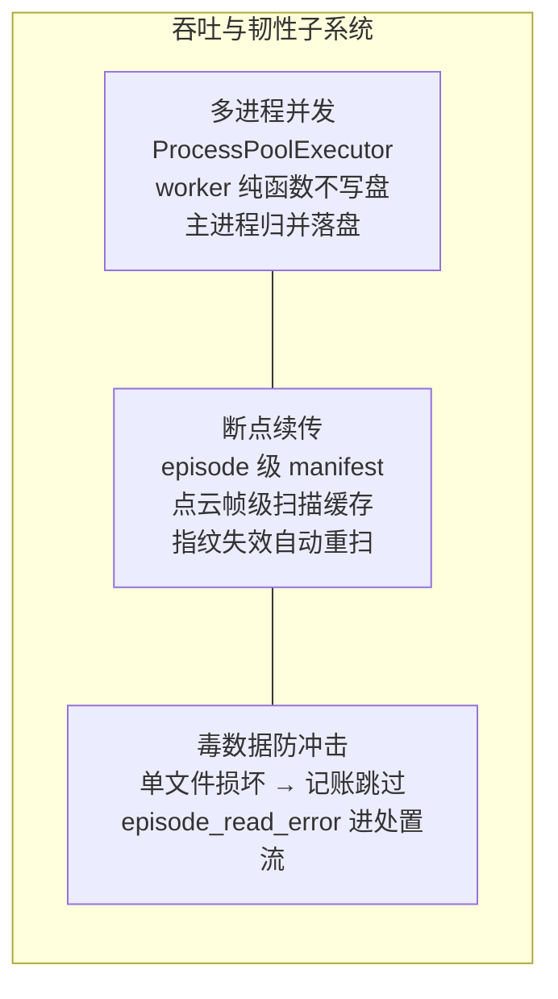

# 架构设计说明书

本文说明这条流水线的设计决策和权衡，使用方式见 README。面向具身智能方向的技术负责人。

---

## 1. 项目定位

### 1.1 定位

在原始采集数据和训练管线之间加一层数据质量治理：对 LeRobot v3 数据集做质检、分级处置、自动修复、留痕报告。只做数据质量工程，不碰训练代码。

### 1.2 分级处置

机器人模仿学习的数据有三个现实约束：

1. 采集成本高。遥操作采一条 episode 是分钟级的人力投入，而控制环丢包产生 NaN、采集中断写坏 parquet、镜头被遮挡、合并批次时重复入库，这些异常在真实产线几乎必然出现。
2. 坏数据的破坏方式是静默的。112 帧里混 11 帧 NaN 会让训练直接崩溃；视频与 state 差 2 帧则不会报错，训练管线会安静地学到错位数据，代价在几周后的评测才暴露。
3. 大多数异常可以救。NaN 只出现在首尾可以裁剪，时间轴错乱可以用 `frame_index/fps` 重建，点云稀疏帧可以按分布补点，meta 索引漂移可以按真实行数重算。

所以系统的核心动作不是过滤，而是分级处置：

| 级别 | 语义 | 业务含义 |
|---|---|---|
| Keep | 通过全部规则 | 直接入库 |
| Repair | 命中可自动修复的异常 | 系统修复并记录修复动作，保留数据 |
| Review | 规则无法裁决（如 action 跳变可能是真实操作） | 导出复核队列转人工，结论可回灌覆盖系统判定 |
| Drop | 不可修复的硬损坏 | 剔除，报告中保留证据链 |

在演示数据集（36 条 episode，注入 13 处异常）上，实测分布是保留 24 / 修复 2 / 复核 2 / 剔除 8。如果按「有异常就删」处理，被删的 13 条里有 4 条本可以回到训练集。

### 1.3 复核回路

自动判定不享有最终裁决权。review / drop 结论导出成带证据的复核队列 CSV（视频路径、时间窗、量化指标），数据工程师填写后通过 `--overrides` 回灌，覆盖系统判定并全程留痕。这是数据治理和一次性清洗脚本的主要区别。

---

## 2. 核心架构

### 2.1 数据流转



### 2.2 关键子系统



三个子系统的实测指标（50 episode / 18374 帧真实数据集）：

| 能力 | 机制 | 实测 |
|---|---|---|
| 并发吞吐 | episode 按条并行，点云按 (文件, row group) 分片并行，结论与串行逐位一致 | 190.1s → 64.7s（workers=8，2.9×） |
| 断点续传 | 无变化时整体短路 35.3s → 1.6s；强制重检时点云缓存命中（27s → 0s） | 修复坏文件后只重扫该分片 |
| 容错 | 人工损坏一个分片：23 个受影响 episode 标记 `episode_read_error` 剔除，其余 27 条正常流转 | 流水线不中断，无异常退出 |

并发写入没有用锁，也没有用临时文件合并，而是在设计上让冲突不存在。worker 是纯函数：只读输入，返回可 pickle 的结果，从不写盘。结果通过线程安全的 `Future` 回传主进程，由主进程归并后统一写 JSON / CSV / parquet。计算与落盘在时间上也分离：`--workers` 只作用于质检阶段（②⑥），清洗写盘（⑤⑦）在质检完成后由主进程单线程执行。契约见 `pipeline/parallel.py` 的模块 docstring。

---

## 3. 设计要点

### 3.1 形状不变式

修复器的第一原则不是「把数据改对」，而是修复产物必须满足下游训练管线的隐含契约：

- 定长：点云修复（过滤 NaN → 去重 → 越界裁剪 → 颜色截断）会减少点数，修复器随后按场景尺度做抖动重采样，补回声明的固定点数（如 512）。下游 DataLoader 看到的仍是 `[N, D]` 批次，不需要为清洗产物写分支逻辑。
- 索引：episode 边界裁剪后，全局 `index` 连续性、`meta/episodes` 的 length、`dataset_from/to_index` 全部按真实行数重建，LeRobot 工具链的消费者感知不到修复发生过。
- schema：清洗用同 schema 的 ParquetWriter 原地重写，视频、任务、统计文件的引用关系保持不变。
- 可验证：清洗末尾有独立的 verify 步骤回读产物，先校验行数和特征列，再完整重跑一遍规则引擎（复检 drop 级 episode 应为 0）。修复引入的新问题不会静默通过，只告警不阻断。

数据治理层因此可以自由演进，训练层不需要跟着改。契约由校验步骤强制执行，不靠文档呼吁。

### 3.2 规则引擎

面对数据质量这个问题，第一个直觉往往是上模型。这里选择规则引擎，原因有三点：

1. 这一层的问题是工程问题，不是语义问题。NaN、帧错位、分布漂移、容器截断都有精确定义和可复现判据。规则引擎给出确定性结论：同一份数据加同一份配置，报告逐位一致（有并发一致性测试钉住）。确定性是审计、diff、追责的前提。
2. 算力成本差三个数量级。规则引擎纯 CPU、零 GPU，18374 帧多模态数据（含 512 点 × 6 维点云）全量质检在分钟级完成，可以放进每次采集后的日常流程。ML 方案的推理成本决定了它只能抽检。
3. 没有冷启动问题。绝对阈值（如「点数 < 5000 就删」）在不同机器人上必然误报，关节量程、点云密度、采样率都不同。这里的阈值是自适应推导的：帧数区间取 `median ± k·1.4826·MAD`，action 跳变按维度取 `median(每集最大|Δ|) + k·MAD(每集最大|Δ|)`，点云离群半径取 `k × 1-NN 距离中位数`。配置里的固定值只是安全边界。换机器人不用改代码。

边界也需要说清楚：规则管「数据是否健全」，管不了「这段操作是否成功、是否有价值」。后者是语义判断，留给 ML，接合点见 §4。

### 3.3 证据结构化

规则不返回布尔值，而是返回结构化证据（`res.add(code, **evidence)`）：量化指标、触发阈值、推导依据、受影响帧号。报告因此能携带数据集指纹、配置快照和自适应阈值的推导过程，两次运行的报告可以机械 diff。质检结果从一段日志变成可审计的工程产物。

### 3.4 编号空间对齐

BEHAVIOR-1K 这类数据集的 `meta/episodes` 用全局 episode ID（420010, 420020, …，步长 10 且带缺口），而 `data/*.parquet` 里的 `episode_index` 是 0..N-1。两侧编号没有交集时，所有依赖 meta 的定位都会落空：

- `frame_mismatch` 每一条都报「视频无法定位」；
- `missing_task` 每一条都报「任务为空」；
- 200/200 episode 被判 error，处置建议是剔掉全部 128 万帧。

数据本身是好的：meta 的 `length` 与数据行数 200/200 逐条相等，视频时间窗帧数也 200/200 等于行数。错的是映射方式。

处理分三层：

1. 加载层自动对齐（`loader._reconcile_episode_ids`）。两侧编号集合不同但 episode 数相同时，按顺序建立候选映射，用两重独立证据校验：`meta.length == 数据行数`、视频时间窗帧数 == 数据行数。两项一致率都 ≥99% 才接受映射（实测均为 1.0）；任何一项证据不足就判 `ambiguous`，拒绝猜测。
2. 规则层区分语义。定位不可用时，`frame_mismatch` / `missing_task` 标记为 `skipped_checks`（不可评估），不产出 episode 级 error。定位失败是工具的能力边界，不是数据的缺陷。
3. 处置层熔断（`policy._apply_systemic_guard`）。任何一条 error 规则的命中率 ≥95% 时，批量 drop 自动降级为 review，并在报告里标【阻断】。删数据不可逆，100% 命中应先怀疑元数据。

报告里的 `dataset.id_reconciliation` 记录映射模式、两侧编号区间、两项一致率和映射样本；`meta_episode_mismatch` 条目上标 `auto_reconciled`，避免被当成未处理的阻断项。

修复前后的结论文档在 `docs/EVAL.md`：20 个 episode 从「20 error / 全量剔除」变为「19 keep + 1 review（真实的 action 跳变）」。

---

## 4. 扩展性

### 4.1 规则即插件

新增一条规则的路径是固定的：在 `RULES` 表登记代码/标签/严重度 → 在 `rules.py` 写检查函数并产出证据 → 在配置里加默认值与严重度 → 在 `policy.py` 声明可修复性。规则的全局统计依赖（如指纹预计算）收敛在 `DatasetContext.build`，流式和并行执行路径自动继承，不需要重写调度逻辑。

### 4.2 配置分层

```text
代码内置 DEFAULT_CONFIG  ←  config.yaml  ←  robots[robot_type]  ←  CLI 显式覆盖
```

接入一家业务方的数据，只需要在 YAML 的 `robots:` 下加一段覆盖（关节限位、action 量程、工作空间包围盒、严重度偏好）。未覆盖的键逐层回退默认值，业务方只写与默认不同的几行。YAML 模板和代码默认值之间有测试强制逐位一致，避免配置与实现双源漂移。

### 4.3 给 ML 预留的接合点

系统不内置 ML，但留了三个接口，接入时不需要改流水线内部：

1. 复核队列契约（推荐）。`review_queue.csv` → `--overrides` 回灌既是人机回路，也是机机回路。一个 ML 打分器只要输出同构 CSV，就能作为自动 reviewer 接入，与人工复核共用同一条审计留痕通道。
2. 规则注册表。ML 推理结果可以实现成一条新规则（如 `ml_semantic_fail`），走标准的证据、严重度、处置配置，自动获得并发、增量、报告能力。
3. 报告产物。`quality_report.json` 的逐 episode 证据结构可以作为 ML 训练的特征源，规则引擎为语义模型生产标注级输入。

### 4.4 面向规模的执行模型

- 流式模式按 parquet 分片扫描两遍，不把全量逐帧表读进内存；
- 视频探针优先读容器元数据（nb_frames / duration×fps），必要时才精确解码，几十 GB 视频集上避免全解码；
- 断点续传的两级缓存（episode 级 manifest + 点云帧级缓存）以文件指纹和配置指纹为命中条件，数据修复、新增、配置变更都会触发最小范围重算。

---

## 5. 开放问题

1. 自适应阈值依赖数据集整体分布。median/MAD 在 50+ episode 上稳定，但极小批次（<10 条）时会退化为安全边界判据。是否需要引入跨批次的阈值记忆（历史分布先验）？
2. 点云时序一致性目前只用质心和包围盒尺度，没有做配准级对齐。动态场景中是否够用，业界有没有更低开销的做法？
3. 视频内容检测只覆盖黑屏和遮挡（抽帧灰度方差）。「操作是否成功」的语义判定留给 ML，但规则与 ML 结论冲突时如何仲裁（谁优先、如何留痕），希望听听经验。
4. 修复边界：目前只做不改变语义的机械操作（裁剪、重建、补点）。是否值得引入修复可信度评分，让下游按可信度加权，而不是二值取舍？

---

## 6. 质量保障

- 334 个单元/集成测试，覆盖串行与并行一致性、断点续传逐位一致、容错注入、配置回退，分支覆盖率实测 74%；
- 并发结果与串行逐位一致（future 完成顺序不确定，归并后按键排序重建）；
- 报告含数据集结构指纹（info.json 字节 + episode/帧计数 + 全部分片的相对路径、大小、mtime，不是全量内容哈希）、配置快照、自适应阈值推导依据，历次运行可 diff；
- 任意单点文件损坏都不中断流水线，只产生带证据的处置结论。

附：本文性能数字来自真实数据集（50 episode / 18374 帧 / 169MB），复现方式见 `tests/` 与 README。
