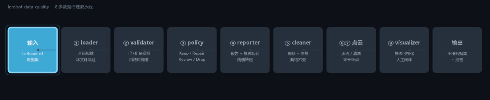
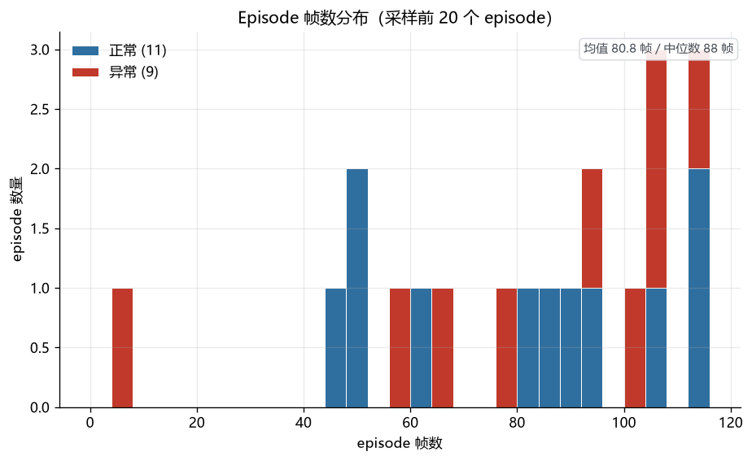
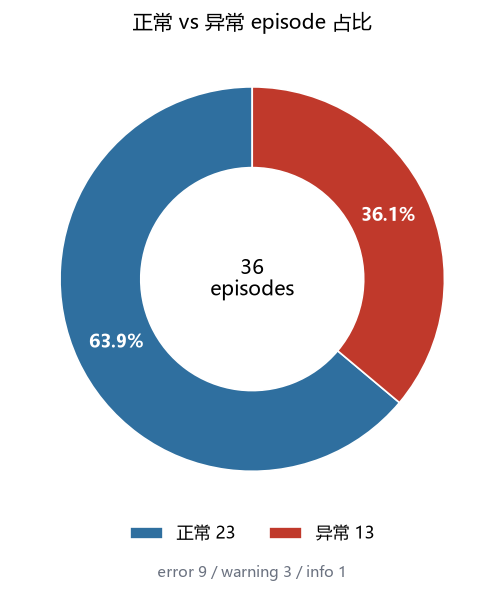
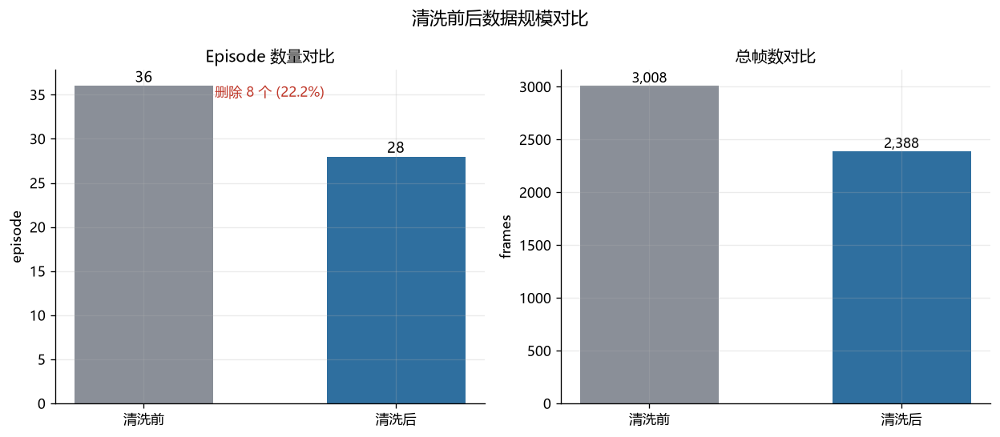

# LeRobot 数据质量治理流水线


对本地 LeRobot v3 数据集做**质检 → 分级处置 → 报告 → 清洗（删除 + 修复）→ 3D 点云质检与清洗 → 可视化**的一站式数据治理工具。只做数据质量工程，不涉及任何训练代码。



## 为什么需要这一层

机器人模仿学习对数据质量极其敏感：一段 112 帧里混着 11 帧 NaN 的 episode 能让训练直接崩溃；一次遥操作接管产生的 action 跳变会污染归一化统计；视频与 state 帧数错位会让训练管线**静默地**学到错位数据。这些问题在真实采集里几乎必然出现（采集中断、控制环丢包、镜头遮挡、合并时重复入库），而 LeRobot 官方工具链只有「加载」和「编辑」能力，没有质检层——本项目补的就是这一层。

## 30 秒跑通

```bash
git clone https://github.com/15389065619/lerobot-data-quality && cd lerobot-data-quality
pip install -e .                                   # 安装依赖与 lerobot-data-quality 命令
python tools/make_demo_dataset.py                   # 生成含 13 处注入异常的演示集
lerobot-data-quality --dataset_path demo_dataset --output_dir outputs
```

产出：`outputs/quality_report.json`、`outputs/review_queue.csv`、`outputs/cleaned_dataset/`、`outputs/plots/`。本仓库的 [`examples/`](examples) 目录是这次运行的快照，可以直接点开看。

没有 Docker 环境也行：

```bash
docker build -t lerobot-data-quality .
docker run --rm \
  -v /path/to/dataset:/data:ro \
  -v /path/to/outputs:/outputs \
  lerobot-data-quality --dataset_path /data --output_dir /outputs
```

## 核心设计决策

| 决策 | 理由 |
|---|---|
| **分级处置**，而非一刀切删除 | 数据稀缺——keep / repair / review / drop 四档，能修则修，实测把 8 条待删数据里的 2 条救了回来 |
| **规则引擎**，而非 ML | 确定性可审计、纯 CPU 分钟级、自适应阈值无冷启动；语义层判断通过复核队列契约留给 ML |
| **计算与落盘分离** | worker 纯函数不写盘，主进程统一写入，并发结果与串行逐位一致 |

完整权衡见 [ARCHITECTURE.md](ARCHITECTURE.md)。

## 效果预览

| 帧数分布（正常/异常分色） | 处置结果占比 |
|---|---|
|  |  |



终端报告长这样（demo_dataset 实测）：

```
正常 23 (63.9%)    异常 13    健康度: 严重（先修采集流程）
  - nan_state                  3 个 episode
  - action_jump                3 个 episode
  - frame_mismatch             1 个 episode
  - blank_video                1 个 episode
  - duplicate_episode          1 个 episode
数据集级问题 [stats_stale] meta/stats.json 与实测数据偏差过大（归一化统计已过期）

保留 24   修复 2   复核 2   剔除 8
  ep    5  error    repair  裁掉首3帧/尾0帧后保留
  ep    7  warning  review  人工复核后决定
  ep   15  warning  repair  用 frame_index/fps 重建时间轴

预计保留    : 28 个 episode, 2388 帧（丢弃 617 帧，裁帧 3 帧）
```

## 与真实业务流程对齐的设计

| 业务问题 | 本项目的做法 |
|---|---|
| 绝对阈值必然误报（不同机器人关节单位不同） | 阈值**自适应**：帧数区间 = median ± k·MAD，action 跳变逐维 = median\|Δ\| + k·1.4826·MAD\|Δ\|，配置里的 floor 只是安全下限 |
| 「有异常就删」浪费大量可救数据 | **分级处置**：keep / repair（自动修复）/ review（转人工）/ drop；时间轴错乱重建、边界坏帧裁剪、meta 索引与 stats 重算，只有不可修复的才删 |
| 质检结论必须能被人推翻 | **人工复核回路**：导出 `review_queue.csv`（带视频路径、时间窗、证据），填写后用 `--overrides` 回灌，覆盖自动判定并留痕 |
| 真正想知道的是「哪批采集有问题」 | **归因分析**：按 episodes 元数据（如采集员/日期/批次）聚合异常率，输出给上游修流程 |
| 全解码统计视频帧数在几十 GB 数据集上不可行 | 视频探针优先读容器元数据（nb_frames / duration×fps），必要时才精确解码 |
| 结论要可追溯 | 报告带**数据集指纹**（内容哈希）、**配置与自适应阈值快照**（含推导依据）、**修复动作清单**，可 diff 历次报告 |

## 质检规则（17 条 + 1 条数据集级）

| 规则 | 级别 | 处置 | 说明 |
|---|---|---|---|
| `nan_state` / `nan_action` | error | drop / **trim** | NaN/Inf；**只出现在首尾时可裁剪保留**，中段才丢弃 |
| `action_jump` | warning | review | 逐维阈值取自「每集最大跳变」的稳健包络（不是逐帧 median，步进保持/度制数据不误报）；超出包络即人审 |
| `frame_count_abnormal` | error | drop | 自适应区间；过短无法构成时序窗口 |
| `timestamp_not_monotonic` | warning | **repair** | 用 frame_index/fps 重建时间轴 |
| `timestamp_step_deviation` | info | keep | 掉帧/时钟抖动，仅记录 |
| `timestamp_drift` | warning | review | `timestamp` 为文件内全局时间时，state 首/末与视频窗 `from/to` 偏移超 `alignment.timestamp_drift_frames`；episode 相对时间轴不适用（无绝对位置可比），交由下一条查时长 |
| `video_span_mismatch` | warning | review | 视频窗跨度与 `frame_count/fps` 偏差超 5%；帧数相等但取错了时间段 |
| `frame_index_gap` | warning | review | `frame_index` 不是 0..n-1 连续序列，视频按帧号切窗会错位 |
| `frame_mismatch` | error | drop | 视频帧数≠state 行数（含 mp4 缺失/截断，±1 帧容差） |
| `meta_index_inconsistent` | warning | **repair** | meta length 漂移 / 全局 index 断裂，按真实行数重建 |
| `missing_task` | warning | review | 任务缺失，可补标 |
| `static_episode` | error | drop | 空转 episode，无效采集 |
| `blank_video` | error | drop | 黑屏/纯色遮挡（抽帧亮度方差） |
| `duplicate_episode` | error | drop | action 序列指纹重复 |
| `joint_limit_violation` | error | drop | 超出关节限位（配置提供 limits 时启用） |
| `episode_read_error` | error | drop | parquet 损坏或 meta 有记录但无数据行 |
| `stats_stale`（数据集级） | warning | **repair** | stats.json 与实测偏差过大 → 重算 |

严重度与阈值都可在 `config/default.yaml` 按 robot_type 覆盖（`robots: {so100_follower: {...}}`）。

## 3D 点云质检与清洗（8 条规则）

针对 `observation.environment_state` 这类 `[N, D]（D≥3，通常 xyz+RGB）` 的二维点云特征。它不进主 DataFrame，`loader` 只记录特征名；点云阶段用 `pyarrow.ParquetFile.iter_batches` **逐批流式读取**，18374 帧 / 512 点也只需要几十 MB 常驻内存。

| 规则 | 级别 | 处置 | 说明 |
|---|---|---|---|
| `pc_non_finite` | error | **repair** | xyz 含 NaN/Inf；过滤坏点后补点 |
| `pc_empty_or_sparse` | error | drop | 有效点 < `max(min_points, N×sparse_ratio)`，无法凭空造几何 |
| `pc_degenerate` | error | drop | 包围盒对角线 ≈0（所有点重合），采集/反投影失败 |
| `pc_duplicate` | warning | **repair** | 量化后重复点比例 > `max_duplicate_ratio`；去重后补点 |
| `pc_outliers` | warning | **repair** | 半径内邻居数 < `outlier_min_neighbors` 的点占比超阈值；半径 = `k × 每帧 1-NN 距离中位数`（默认 k=2.5），跟点云自身密度走 |
| `pc_out_of_bounds` | error | **repair** | 超出工作空间包围盒的点占比 > `max_outside_ratio`；包围盒由样本帧 0.5%/99.5% 分位数 + 10% 边距自动推导 |
| `pc_color_invalid` | warning | **repair** | RGB 为负或超过量程（自动识别 0~1 / 0~255）；裁剪到合法区间 |
| `pc_temporal_jump` | warning | review | 相邻帧质心跳变 > `max(abs_jump, median×mad_k)`；可能是坐标系切换/跟踪丢失，必须回放确认，不改数据 |

**处置与修复链**

- `keep / repair / review / drop` 四档，逻辑与数值质检一致
- 可修复坏点比例 > `max_repair_ratio`（默认 35%）→ 判 `drop`，避免用抖动点大规模伪造几何
- repair 流程：过滤非有限点 → 去离群 → 去重 → 颜色裁剪 → **抖动重采样补回固定点数**
- `drop` 帧用**同 episode 最近的好帧占位（hold-last-good）**，保证 parquet 行数、state/action、视频时间窗始终对齐
- 修复后必须仍是 `N 点 × D 维`（LeRobot Array2D 契约），并保留 `ARROW:extension:name` 元数据
- 修复完重算 `meta/stats.json` 里点云特征的统计，并写 `meta/pointcloud_cleaning_notes.json` 留痕

点云阶段放在 `cleaner` **之后**（episode 可能被重编号），在清洗产物 `cleaned_dataset` 上重跑质检并**原地 patch**；若跳过/失败清洗，则退回原数据集**只读**，独立输出到 `outputs/pointcloud_cleaned/`，绝不修改用户源数据。

## 上游数据源适配（可选）

仓库附带两个**独立可选**的上游适配器（`src/lerobot_data_quality/`），不依赖、也不影响 `pipeline/` 主线；不使用它们时整条流水线行为不变。输出都与 LeRobot 帧表同构（`episode_index / frame_index / timestamp / observation.state / action`），缺陷**不在加载层裁决**：丢帧表现为时间戳缺口，NaN/跳变原样进 state，交给下游质检规则统一标记。

**ROS Bag 适配器**：用纯 Python 的 rosbags 库（无需 ROS 环境）解析 rosbag1 `.bag` / rosbag2（目录或 `.db3`）/ `.mcap`，把 `/joint_states` 与相机 topic 用 `pandas.merge_asof` 最近邻对齐到同一时间轴（`action` 取下一帧 `state`）。可选依赖：`pip install lerobot-data-quality[rosbag]`。

```bash
python tools/make_demo_rosbag.py   # 生成演示 bag（100Hz 关节 + 30Hz 相机），
                                   # 注入乱序 / 重复时间戳 / 相机丢帧三类异常
```

```python
from lerobot_data_quality.loaders import RosbagAdapter

df = RosbagAdapter("examples/rosbag_sim/episode_000.bag").to_dataframe()  # topic 名均可配
# → 300 帧 × 6 关节：乱序排序恢复、重复时间戳去重（均有 warning 留痕）；
#   相机丢帧窗口（~1.5s，超 50ms 容差）的 camera_timestamp 为 NaN —— 缺口不插值
```

基准时间轴可配：`base="state"`（默认，关节轴，无信息损失）或 `base="image"`（按相机帧率出帧）；`match_direction="backward"` 可强制严格因果（不取未来状态）。

**FZMotion 风格动捕 CSV 适配器**：把光学动捕长表 CSV 转宽表帧表。

```bash
python examples/fzmotion_sim/generate_fzmotion_csv.py   # 生成 120 FPS × 10s × 6 marker 的模拟数据
```

```python
from lerobot_data_quality.loaders import load_fzmotion_csv, load_fzmotion_csv_dir

df_one = load_fzmotion_csv("examples/fzmotion_sim/episode_000.csv", episode_index=0)
df_all = load_fzmotion_csv_dir("examples/fzmotion_sim")   # 多 episode 合并
```

## 在线 Dashboard / 训练前预检 / 版本管理 / 策略学习

这五件事分别解决「看得见」「挡得住」「退得回」「越跑越准」「对得齐」。

### 1. Web Dashboard（在线看每集曲线 + 视频片段）

```bash
python tools/dashboard_server.py --dataset_path demo_dataset --output_dir outputs --open
# 或安装后：lerobot-data-quality-dashboard --dataset_path demo_dataset --output_dir outputs
```

- 左侧按 keep/repair/review/drop 过滤 episode；右侧看 **action / state 多维度曲线**
- 曲线按需从 parquet 流式读取（`--max_points` 控制采样点，长 episode 不卡）
- ECharts 走 CDN，**离线/内网自动降级到原生 canvas 折线**，不装任何前端依赖也能看
- NaN/Inf 在 API 层转 `null`，坏数据处曲线直接断开（`JSON.parse` 不会因 `NaN` 崩掉）
- 视频按 meta 的 `from_timestamp / to_timestamp` 自动用 `#t=from,to` 截取片段；
  服务端实现 **HTTP Range**，拖动进度条不重新下载整段 mp4
- 点云坏帧直接叠加在 episode 详情里
- 纯标准库 `http.server`，不引入 Web 框架；`/healthz` 可直接接 k8s 探针

### 2. 训练前预检：脏数据直接拦在训练门口

```python
# train.py
from pipeline.precheck import precheck, DirtyDatasetError

def train(dataset_path):
    precheck(dataset_path, strict=True)   # 有 drop 级 episode → 抛异常，训练不会白跑 8 小时
    ...
```

```bash
python -m pipeline.precheck --dataset_path /data/gym_xarm --strict
# 退出码：0 通过 / 2 被 drop 级数据阻断；--json 落盘结论，可直接接入 CI
```

预检**只读**：不写数据集、不生成清洗产物，几秒钟给出「能不能开训」的结论。
`repair / review` 不阻断，只告警；需要更严格可加 `--on-review drop`。

### 3. 数据集版本管理（类 DVC，支持回滚）

```bash
python -m pipeline.versions --dataset_path data/gym_xarm commit --note "清洗前基线"
python -m pipeline.versions --dataset_path data/gym_xarm log
python -m pipeline.versions --dataset_path data/gym_xarm diff --from <v1> --to <v2>
python -m pipeline.versions --dataset_path data/gym_xarm restore --version <v1>          # 只出 plan
python -m pipeline.versions --dataset_path data/gym_xarm restore --version <v1> --apply  # 真回滚
```

- 内容寻址存储（`.lrdq/objects/<sha1 前两位>/<sha1>`），同一文件多版本只存一份
- 增量快照：`mtime_ns + size` 未变的文件直接沿用父版本哈希，二次快照几乎不耗 IO
- 回滚默认 **dry-run**，必须 `--apply` 才写盘；目标版本缺对象时直接拒绝，避免半套数据
- 默认不删目标版本里不存在的文件（需要时加 `--delete-extra`）

### 4. 自动修复策略学习（人审数据 → 阈值建议）

```bash
python -m pipeline.tuning --report outputs/quality_report.json \
    --reviews outputs/review_queue_reviewed.csv --out config/tuned.yaml
```

- 按规则统计「命中且被复核」的 episode 里人最终 `drop` 的比例
- 剔除率 ≥80% 且样本 ≥2 → 建议升级 `severity: error`；≤20% 且样本 ≥3 → 建议降级 `info`
- 对 `action_jump.max_delta` 之类带数值证据的规则，做 keep/drop 两组**可分离性分析**，
  能分开时给出 `suggested_cut`
- 只输出 **YAML patch**，必须人工评审后合并进 `config/default.yaml`：判定规则始终可审计，
  机器学习只「提议」不「静默生效」

### 5. 多模态对齐（state / action / 视频 / 点云）

新增 3 条跨模态规则，与原有「单模态各自是否合理」互不重叠：

| 维度 | 检查 | 规则 |
|---|---|---|
| 位置 | 全局 `timestamp` 的首/末 vs 视频窗 `from/to`（容差 `timestamp_drift_frames`）；episode 相对时间轴跳过 | `timestamp_drift` |
| 长度 | 视频窗跨度 vs `frame_count/fps`（相对容差 5%） | `video_span_mismatch` |
| 连续性 | `frame_index` 必须是 `0..n-1` | `frame_index_gap` |
| 点云 | 点云帧数 vs parquet 行数（`pointcloud_report.frame_alignment`） | 数据集级告警 |

## 安装与运行

```bash
python -m venv .venv
.venv/Scripts/pip install -r requirements.txt          # Windows
.venv/Scripts/pip install -r requirements-dev.txt      # 开发/测试
python -m pytest tests                                  # 101 个单测
```

> 打包与发布配置（`pyproject.toml` + console 脚本 + PyPI Trusted Publishing workflow）已就绪；未上传 PyPI 前请从源码 `pip install -e .` 安装。

```bash
python main.py --dataset_path path/to/dataset --output_dir outputs

# 只体检前 20 个 episode
python main.py --dataset_path demo_dataset --output_dir outputs --max_episodes 20

# warning 级一律剔除（不经人工）
python main.py --dataset_path demo_dataset --output_dir outputs --on-review drop

# 人工复核后回灌（第二次运行）
python main.py --dataset_path demo_dataset --output_dir outputs_run2 --overrides outputs/review_queue_reviewed.csv

# 自定义阈值（按机器人型号）
python main.py --dataset_path ... --config config/default.yaml

# 只跑数值质检与报告，跳过点云阶段
python main.py --dataset_path ... --output_dir outputs --skip-pointcloud

# 点云人工复核后回灌（第二次运行）
python main.py --dataset_path ... --output_dir outputs \
  --pointcloud-overrides outputs/pointcloud_review_queue.csv

# 增量模式：只重检变更过的 episode，清洗计划未变则复用上次产出
python main.py --dataset_path demo_dataset --output_dir outputs --incremental

# 流式模式：按 parquet 分片扫描，不把整张逐帧表读进内存（大数据集；暂不支持清洗）
python main.py --dataset_path big_dataset --output_dir outputs --streaming
```

| 参数 | 默认 | 说明 |
|---|---|---|
| `--dataset_path` / `--output_dir` | 必填 / `outputs` | 数据集根目录 / 输出根目录 |
| `--max_episodes` | 全量 | 只处理前 N 个 episode |
| `--config` | 内置默认 | 策略配置 YAML/JSON（按 robot_type 覆盖阈值） |
| `--overrides` | 无 | 人工复核结果 CSV |
| `--on-review` | `keep` | 未经复核的 warning 如何处置（keep/drop） |
| `--workers` | 1 | 并发进程数（仅作用于质检阶段） |
| `--skip-clean` / `--skip-plots` / `--no-cli` | 关 | 跳过对应阶段 / 禁用官方 CLI |
| `--skip-pointcloud` | 关 | 跳过点云质检与清洗（无点云数据集可加） |
| `--pointcloud-feature` | 自动识别 | 指定点云列名（如 `observation.environment_state`） |
| `--pointcloud-max-frames` | 全量 | 只校验前 N 帧点云（调试用） |
| `--pointcloud-overrides` | 无 | 点云复核结果 CSV |
| `--incremental` | 关 | 增量/断点续传：episode 级复用 manifest，点云帧级复用缓存 |
| `--manifest` / `--force` | `quality_manifest.json` / 关 | 增量状态文件路径 / 忽略缓存强制全量重跑 |
| `--streaming` | 关 | 流式模式：按 parquet 分片扫描（自动跳过清洗） |
| `--plots-sample` | 20 | 可视化采样数 |
| `--min-frames` / `--max-frames` / `--action-jump-threshold` | 自适应 | 快捷固定阈值（会切换出 fixed 模式） |

无数据？`python tools/make_demo_dataset.py` 生成一份含 13 处注入异常的演示集。

## 输出说明

```
outputs/
├── quality_report.json      # 指纹、阈值快照、逐 episode 明细（帧号级证据）、
│                            #   处置统计、数据集级问题、归因分析、建议
├── quality_manifest.json    # 增量模式状态：episode 指纹、阈值快照、清洗产出缓存
├── review_queue.csv         # 人工复核队列：填 reviewer_disposition 后可 --overrides 回灌
├── pointcloud_report.json   # 点云质检：自适应阈值、逐帧处置、证据、修复动作、前后对比样本
├── pointcloud_review_queue.csv  # 点云复核队列：填 reviewer_disposition 后可 --pointcloud-overrides 回灌
├── cleaned_dataset/         # 清洗后数据集：删除 + 修复、索引重映射归零、视频按时间窗重建、
│                            #   stats 重算、点云原地 patch、meta/*_cleaning_notes.json 留痕
├── pointcloud_cleaned/      # 仅当没有清洗产物时生成：点云独立清洗输出（源数据集保持只读）
├── plots/                   # 帧数分布 / 占比 / 关节曲线 / action 散点 / 清洗前后对比
└── intermediate/            # 各阶段中间结果（01~07），任一步中断均可复用
```

**安全约束**：源数据集严格只读（输出目录禁止等于/位于源数据集内部，有单测保障）；每个 episode 删了什么、修了什么、重映射到哪，全部记录在 `quality_cleaning_notes.json`。

## 实测摘要

| 场景 | 数据 | 结论 |
|---|---|---|
| demo_dataset | 36 episode / 3008 帧 | 13 处注入异常全命中、0 误报；保留 24 / 修复 2 / 复核 2 / 剔除 8；归因定位到采集人 |
| 真实点云数据集 | 50 episode / 18374 帧 | 8 步全跑通；点云 18374 帧全正常；故障注入 8 类规则全命中，修复后行数/点数/schema 全不变 |
| 并发 | 同上 | `--workers 8`：190.1 s → 64.7 s（2.9×），产物与串行逐字节一致 |
| 容错 + 续传 | 人为损坏 1 个分片 | 不中断（23 episode 标 `episode_read_error`）；二跑 1.6 s；修复后自动重扫并全部恢复 |

详细数字、注入表与边界说明见 [docs/EVAL.md](docs/EVAL.md)。

## 快速导航

| 文档 | 内容 |
|---|---|
| [ARCHITECTURE.md](ARCHITECTURE.md) | 架构设计说明书：业务痛点、架构图、契约思维、为何规则而非 ML、扩展性 |
| [docs/COMPARISON.md](docs/COMPARISON.md) | 与 LeRobot 官方工具 / ROS 工具链 / OpenVLA 数据管线的对比与选型建议 |
| [docs/EVAL.md](docs/EVAL.md) | 全量实测记录、故障注入表、已知边界 |
| [docs/INTERVIEW.md](docs/INTERVIEW.md) | 项目讲解话术与高频追问的回答要点 |

## 技术栈

pandas + pyarrow（清洗直接操作 Arrow 表，保住 `fixed_size_list` / `Array2D` schema；点云按 batch 流式读写）、ffprobe/ffmpeg（帧探针与视频重建）、matplotlib（可视化）、pytest（101 个单测）、GitHub Actions（3.10/3.11/3.12 三版本矩阵）。**不强依赖 lerobot 包**（体积大）；安装了 lerobot 时，纯删除场景自动优先走官方 `lerobot-edit-dataset` CLI，存在修复项时强制走内置实现（CLI 只能删不能修）。

## 数据集格式（LeRobot v3.0）

```
dataset/
├── data/chunk-000/file-000.parquet          # 多 episode 合并存储
├── meta/info.json, stats.json, tasks.parquet
├── meta/episodes/chunk-000/file-000.parquet # length、tasks、视频 chunk/file/from/to_timestamp
└── videos/<camera>/chunk-000/file-000.mp4   # 多 episode 拼接，按时间窗切分
```

兼容 v2.1 布局（episode-per-file、episodes.jsonl、tasks.jsonl）。
