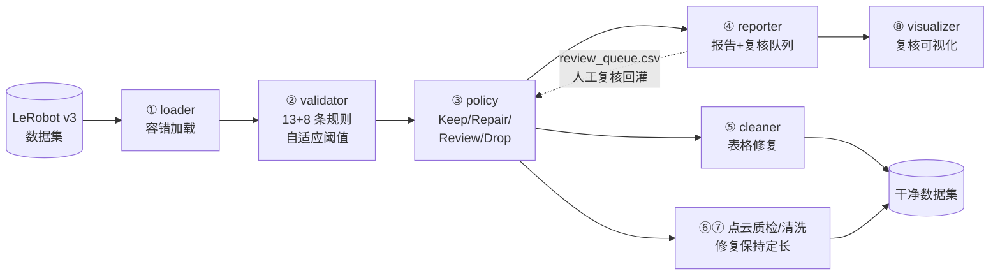
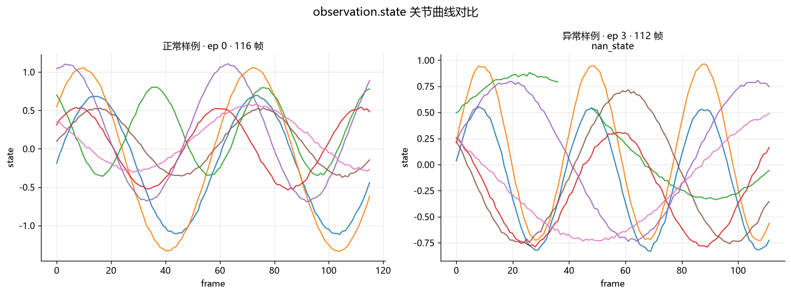
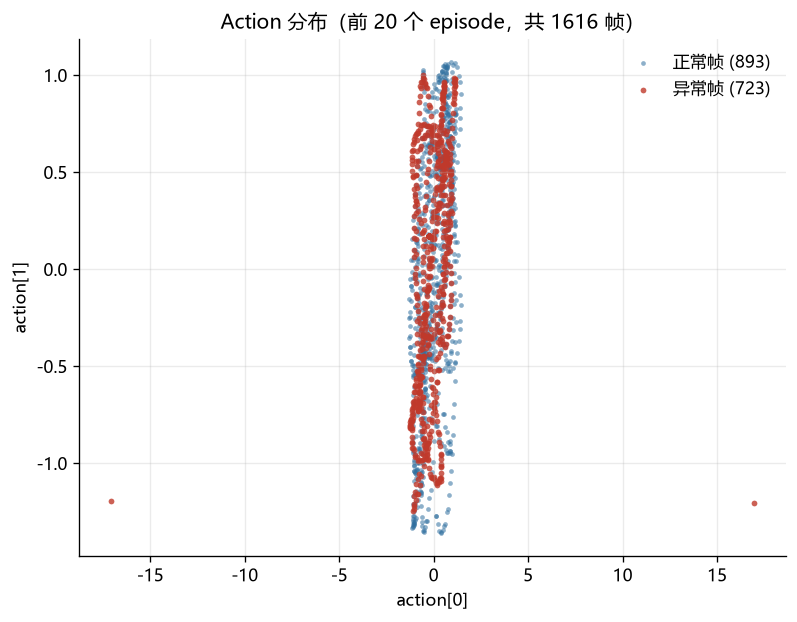

# LeRobot 数据质量校验与清洗 Pipeline

对本地 LeRobot v3 数据集做**质检 → 分级处置 → 报告 → 清洗（删除 + 修复）→ 3D 点云质检与清洗 → 可视化**的一站式数据治理工具。只做数据质量工程，不涉及任何训练代码。

整条流水线固定 8 步：`loader(1) → validator(2) → policy(3) → reporter(4) → cleaner(5) → pointcloud 质检(6) → pointcloud 清洗(7) → visualizer(8)`。

## 解决的问题

机器人模仿学习对数据质量极其敏感：一段 112 帧里混着 11 帧 NaN 的 episode 能让训练直接崩溃；一次遥操作接管产生的 action 跳变会污染归一化统计；视频与 state 帧数错位会让训练管线**静默地**学到错位数据。这些问题在真实采集里几乎必然出现（采集中断、控制环丢包、镜头遮挡、合并时重复入库），而 LeRobot 官方工具链只有「加载」和「编辑」能力，没有质检层——本项目补的就是这一层。

## 架构速览



核心设计决策：**分级处置**而非一刀切删除（数据稀缺，能救则救）；**规则引擎**而非 ML（确定性可审计、纯 CPU 分钟级、自适应阈值无冷启动，语义判断通过复核队列契约留给 ML）；**计算与落盘分离**的并发模型（worker 纯函数不写盘，主进程统一写入，结果与串行逐位一致）。完整设计权衡见 [ARCHITECTURE.md](ARCHITECTURE.md)。

## 30 秒跑通

```bash
pip install -r requirements.txt
python tools/make_demo_dataset.py --output demo_dataset --episodes 36   # 生成含 13 处注入异常的演示集
python main.py --dataset_path demo_dataset --output_dir outputs
```

产出：`outputs/quality_report.json`、`outputs/review_queue.csv`、`outputs/cleaned_dataset/`、`outputs/plots/`。本仓库的 [`examples/`](examples) 目录是这次运行的快照，可以直接点开看。

## 效果预览

| 帧数分布（正常/异常分色） | 处置结果占比 |
|---|---|
|  |  |

| 关节曲线（正常 vs 异常 episode 对照） | action 分布 |
|---|---|
|  |  |


终端报告长这样（demo_dataset 实测）：

```
正常 23 (63.9%)    异常 13    健康度: 严重（先修采集流程）
  - nan_state                  3 个 episode
  - action_jump                3 个 episode
  - frame_mismatch             1 个 episode
  - blank_video                1 个 episode
  - duplicate_episode          1 个 episode
数据集级问题 [stats_stale] meta/stats.json 与实测数据偏差过大（归一化统计已过期）

保留 24   修复 2   复核 2   剔除 8
  ep    5  error    repair  裁掉首3帧/尾0帧后保留
  ep    7  warning  review  人工复核后决定
  ep   15  warning  repair  用 frame_index/fps 重建时间轴

预计保留    : 28 个 episode, 2388 帧（丢弃 617 帧，裁帧 3 帧）
```

## 与真实业务流程对齐的设计

| 业务问题 | 本项目的做法 |
|---|---|
| 绝对阈值必然误报（不同机器人关节单位不同） | 阈值**自适应**：帧数区间 = median ± k·MAD，action 跳变逐维 = median\|Δ\| + k·1.4826·MAD\|Δ\|，配置里的 floor 只是安全下限 |
| 「有异常就删」浪费大量可救数据 | **分级处置**：keep / repair（自动修复）/ review（转人工）/ drop；时间轴错乱重建、边界坏帧裁剪、meta 索引与 stats 重算，只有不可修复的才删 |
| 质检结论必须能被人推翻 | **人工复核回路**：导出 `review_queue.csv`（带视频路径、时间窗、证据），填写后用 `--overrides` 回灌，覆盖自动判定并留痕 |
| 真正想知道的是「哪批采集有问题」 | **归因分析**：按 episodes 元数据（如采集员/日期/批次）聚合异常率，输出给上游修流程 |
| 全解码统计视频帧数在几十 GB 数据集上不可行 | 视频探针优先读容器元数据（nb_frames / duration×fps），必要时才精确解码 |
| 结论要可追溯 | 报告带**数据集指纹**（内容哈希）、**配置与自适应阈值快照**（含推导依据）、**修复动作清单**，可 diff 历次报告 |

## 质检规则（13 条）

| 规则 | 级别 | 处置 | 说明 |
|---|---|---|---|
| `nan_state` / `nan_action` | error | drop / **trim** | NaN/Inf；**只出现在首尾时可裁剪保留**，中段才丢弃 |
| `action_jump` | warning | review | 逐维自适应阈值；可能是真实动作突变，必须人审 |
| `frame_count_abnormal` | error | drop | 自适应区间；过短无法构成时序窗口 |
| `timestamp_not_monotonic` | warning | **repair** | 用 frame_index/fps 重建时间轴 |
| `timestamp_step_deviation` | info | keep | 掉帧/时钟抖动，仅记录 |
| `frame_mismatch` | error | drop | 视频帧数≠state 行数（含 mp4 缺失/截断，±1 帧容差） |
| `meta_index_inconsistent` | warning | **repair** | meta length 漂移 / 全局 index 断裂，按真实行数重建 |
| `missing_task` | warning | review | 任务缺失，可补标 |
| `static_episode` | error | drop | 空转 episode，无效采集 |
| `blank_video` | error | drop | 黑屏/纯色遮挡（抽帧亮度方差） |
| `duplicate_episode` | error | drop | action 序列指纹重复 |
| `joint_limit_violation` | error | drop | 超出关节限位（配置提供 limits 时启用） |
| `stats_stale`（数据集级） | warning | **repair** | stats.json 与实测偏差过大 → 重算 |

严重度与阈值都可在 `config/default.yaml` 按 robot_type 覆盖（`robots: {so100_follower: {...}}`）。

## 3D 点云质检与清洗（8 条规则）

针对 `observation.environment_state` 这类 `[N, D]（D≥3，通常 xyz+RGB）` 的二维点云特征。它不进主 DataFrame，`loader` 只记录特征名；点云阶段用 `pyarrow.ParquetFile.iter_batches` **逐批流式读取**，18374 帧 / 512 点也只需要几十 MB 常驻内存。

| 规则 | 级别 | 处置 | 说明 |
|---|---|---|---|
| `pc_non_finite` | error | **repair** | xyz 含 NaN/Inf；过滤坏点后补点 |
| `pc_empty_or_sparse` | error | drop | 有效点 < `max(min_points, N×sparse_ratio)`，无法凭空造几何 |
| `pc_degenerate` | error | drop | 包围盒对角线 ≈0（所有点重合），采集/反投影失败 |
| `pc_duplicate` | warning | **repair** | 量化后重复点比例 > `max_duplicate_ratio`；去重后补点 |
| `pc_outliers` | warning | **repair** | 半径内邻居数 < `outlier_min_neighbors` 的点占比超阈值；半径 = `k × 每帧 1-NN 距离中位数`（默认 k=2.5），跟点云自身密度走 |
| `pc_out_of_bounds` | error | **repair** | 超出工作空间包围盒的点占比 > `max_outside_ratio`；包围盒由样本帧 0.5%/99.5% 分位数 + 10% 边距自动推导 |
| `pc_color_invalid` | warning | **repair** | RGB 为负或超过量程（自动识别 0~1 / 0~255）；裁剪到合法区间 |
| `pc_temporal_jump` | warning | review | 相邻帧质心跳变 > `max(abs_jump, median×mad_k)`；可能是坐标系切换/跟踪丢失，必须回放确认，不改数据 |

**处置与修复链**：

- `keep / repair / review / drop` 四档，逻辑与数值质检一致；
- 可修复坏点比例 > `max_repair_ratio`（默认 35%）→ 判 `drop`，避免用抖动点大规模伪造几何；
- repair 流程：过滤非有限点 → 去离群 → 去重 → 颜色裁剪 → **抖动重采样补回固定点数**；
- `drop` 帧用**同 episode 最近的好帧占位（hold-last-good）**，保证 parquet 行数、state/action、视频时间窗始终对齐；
- 修复后必须仍是 `N 点 × D 维`（LeRobot Array2D 契约），并保留 `ARROW:extension:name` 元数据；
- 修复完重算 `meta/stats.json` 里点云特征的统计，并写 `meta/pointcloud_cleaning_notes.json` 留痕。

**在流水线里的位置**：点云阶段放在 `cleaner` **之后**（episode 可能被重编号），在清洗产物 `cleaned_dataset` 上重跑质检并**原地 patch 它的 parquet**；若跳过/失败清洗，则退回原数据集**只读**，独立输出到 `outputs/pointcloud_cleaned/`，绝不修改用户源数据。

## FZMotion 风格 CSV 适配（可选）

除 LeRobot Parquet 主线外，仓库附带一个**独立可选**的 FZMotion 风格动捕 CSV 适配器，位于 `src/lerobot_data_quality/`——独立包，不依赖、也不影响 `pipeline/` 主线的任何代码；不使用它时整条流水线行为不变。

- **输入**：`timestamp, marker_id, x, y, z` 长表 CSV（每个采样帧 N 个 marker 行）
- **输出**：与 LeRobot 帧表同构的 DataFrame：`episode_index / frame_index / timestamp / observation.state / action`
  - `observation.state`：按 marker_id 升序拼接的 3N 维向量；某帧缺某个 marker 时对应三元组补 NaN
  - `action`：定义为下一帧 state（最后一帧保持自身，定长契约）
- **缺陷不在这里裁决**：丢帧表现为时间戳缺口，NaN/跳变原样保留进 state——加载器不重采样、不插值，交给下游质检规则（`nan_state` / `action_jump` / `timestamp_step_deviation` 等）统一标记

```bash
# 生成模拟数据（120 FPS × 10 秒 × 6 marker，注入丢帧/NaN/坐标跳变）
python examples/fzmotion_sim/generate_fzmotion_csv.py
```

```python
from lerobot_data_quality.loaders import load_fzmotion_csv, load_fzmotion_csv_dir

df_one = load_fzmotion_csv("examples/fzmotion_sim/episode_000.csv", episode_index=0)
df_all = load_fzmotion_csv_dir("examples/fzmotion_sim")   # 多 episode 合并
```

## 技术栈

pandas + pyarrow（清洗直接操作 Arrow 表，保住 `fixed_size_list` / `Array2D` schema；点云按 batch 流式读写）、ffprobe/ffmpeg（帧探针与视频重建）、matplotlib（可视化）、pytest（43 个单测）。**不强依赖 lerobot 包**（体积大）；安装了 lerobot 时，纯删除场景自动优先走官方 `lerobot-edit-dataset` CLI，存在修复项时强制走内置实现（CLI 只能删不能修）。

## 数据集格式（LeRobot v3.0）

```
dataset/
├── data/chunk-000/file-000.parquet          # 多 episode 合并存储
├── meta/info.json, stats.json, tasks.parquet
├── meta/episodes/chunk-000/file-000.parquet # length、tasks、视频 chunk/file/from/to_timestamp
└── videos/<camera>/chunk-000/file-000.mp4   # 多 episode 拼接，按时间窗切分
```
兼容 v2.1 布局（episode-per-file、episodes.jsonl、tasks.jsonl）。

## 安装与运行

```bash
python -m venv .venv
.venv/Scripts/pip install -r requirements.txt          # Windows
.venv/Scripts/pip install -r requirements-dev.txt      # 开发/测试
python -m pytest tests                                  # 43 个单测
```

```bash
python main.py --dataset_path path/to/dataset --output_dir outputs

# 只体检前 20 个 episode
python main.py --dataset_path demo_dataset --output_dir outputs --max_episodes 20

# warning 级一律剔除（不经人工）
python main.py --dataset_path demo_dataset --output_dir outputs --on-review drop

# 人工复核后回灌（第二次运行）
python main.py --dataset_path demo_dataset --output_dir outputs_run2 --overrides outputs/review_queue_reviewed.csv

# 自定义阈值（按机器人型号）
python main.py --dataset_path ... --config config/default.yaml

# 只跑数值质检与报告，跳过点云阶段
python main.py --dataset_path ... --output_dir outputs --skip-pointcloud

# 点云人工复核后回灌（第二次运行）
python main.py --dataset_path ... --output_dir outputs \
  --pointcloud-overrides outputs/pointcloud_review_queue.csv

# 增量模式：只重检变更过的 episode，清洗计划未变则复用上次产出
python main.py --dataset_path demo_dataset --output_dir outputs --incremental

# 流式模式：按 parquet 分片扫描，不把整张逐帧表读进内存（大数据集；暂不支持清洗）
python main.py --dataset_path big_dataset --output_dir outputs --streaming
```

| 参数 | 默认 | 说明 |
|---|---|---|
| `--dataset_path` / `--output_dir` | 必填 / `outputs` | 数据集根目录 / 输出根目录 |
| `--max_episodes` | 全量 | 只处理前 N 个 episode |
| `--config` | 内置默认 | 策略配置 JSON |
| `--overrides` | 无 | 人工复核结果 CSV |
| `--on-review` | `keep` | 未经复核的 warning 如何处置（keep/drop） |
| `--skip-clean` / `--skip-plots` / `--no-cli` | 关 | 跳过对应阶段 / 禁用官方 CLI |
| `--skip-pointcloud` | 关 | 跳过点云质检与清洗（无点云数据集可加，省 2~3 分钟） |
| `--pointcloud-feature` | 自动识别 | 指定点云列名（如 `observation.environment_state`） |
| `--pointcloud-max-frames` | 全量 | 只校验前 N 帧点云（调试用） |
| `--pointcloud-overrides` | 无 | 点云复核结果 CSV |
| `--incremental` | 关 | 增量模式：按 episode 指纹复用未变更结论 |
| `--manifest` / `--force` | `quality_manifest.json` / 关 | 增量状态文件路径 / 忽略缓存强制全量重跑 |
| `--streaming` | 关 | 流式模式：按 parquet 分片扫描（自动跳过清洗） |
| `--plots-sample` | 20 | 可视化采样数 |
| `--min-frames` / `--max-frames` / `--action-jump-threshold` | 自适应 | 快捷固定阈值（会切换出 fixed 模式） |

无数据？`python tools/make_demo_dataset.py` 生成一份含 13 处注入异常的演示集。

## 输出说明

```
outputs/
├── quality_report.json      # 指纹、阈值快照、逐 episode 明细（帧号级证据）、
│                            #   处置统计、数据集级问题、归因分析、建议
├── quality_manifest.json    # 增量模式状态：episode 指纹、阈值快照、清洗产出缓存
├── review_queue.csv         # 人工复核队列：填 reviewer_disposition 后可 --overrides 回灌
├── pointcloud_report.json   # 点云质检：自适应阈值、逐帧处置、证据、修复动作、前后对比样本
├── pointcloud_review_queue.csv  # 点云复核队列：填 reviewer_disposition 后可 --pointcloud-overrides 回灌
├── cleaned_dataset/         # 清洗后数据集：删除 + 修复、索引重映射归零、视频按时间窗重建、
│                            #   stats 重算、点云原地 patch、meta/*_cleaning_notes.json 留痕
├── pointcloud_cleaned/      # 仅当没有清洗产物时生成：点云独立清洗输出（源数据集保持只读）
├── plots/                   # 帧数分布 / 占比 / 关节曲线 / action 散点 / 清洗前后对比
└── intermediate/            # 各阶段中间结果（01~07），任一步中断均可复用
```

**安全约束**：源数据集严格只读（输出目录禁止等于/位于源数据集内部，有单测保障）；每个 episode 删了什么、修了什么、重映射到哪，全部记录在 `quality_cleaning_notes.json`。

## 实测（demo_dataset，36 episode / 3008 帧 / 2 相机）

- 13 处注入异常全部命中，**0 误报**（自适应阈值下正常轨迹不触发跳变告警）
- 处置：保留 24 / 修复 2（边界裁帧、时间轴重建）/ 复核 2 / 剔除 8
- 修复验证：裁帧后 NaN 归零，重建的时间轴与 `frame_index/fps` 完全一致
- 清洗后 28 episode / 2388 帧，`length==rows`、视频窗口==行数、index 连续、stats 对齐
- 复核回灌：override 后 ep7 剔除 / ep23 保留，报告标注「人工覆盖 2 条」
- 归因：bob 批次异常率 44.4% vs alice 27.8%，直接定位到人
- 35 个数值/清洗/增量/流式单测 + 8 个点云单测（合计 43），覆盖全部规则的正反例、处置策略、清洗不变量与「源数据零改动」

## 实测（真实点云数据集 gym_xarm_pointcloud）

数据集：HuggingFace `rishabhrj11/gym-xarm-pointcloud`（LeRobot v3.0 原生点云，50 episode / 18374 帧 / 4 相机 224×224 / 点云 512×6）。

```bash
python main.py --dataset_path data/gym_xarm_pointcloud --output_dir outputs_pc_full
```

- 全流程 **8 步跑通，170s**；`observation.environment_state` 被识别为重型二维特征（512×6），流式读取不占主内存
- 数值质检：50/50 episode 正常；点云质检：18374/18374 帧正常（0 NaN / 0 离群 / 0 重复 / 0 越界 / 0 颜色异常）
- 点云自适应阈值实测：场景尺度 1.138m，离群半径 0.0615m（1-NN 中位数 0.0246m × 2.5），工作空间 `[0.87,-0.21,0.43] ~ [1.89,0.78,0.97]`
- 修复链路走 `noop`（数据本身干净），产物为完整 `cleaned_dataset`（含 4 路视频），`pointcloud_report.json` / `pointcloud_review_queue.csv` 正常生成

**真实数据故障注入**（复制 1809 帧真实分片，注入 8 类坏帧后重跑点云质检+清洗）：

| 注入 | 命中规则 | 处置 |
|---|---|---|
| 1 点 NaN | `pc_non_finite` | repair |
| 25% 重复点 | `pc_duplicate` | repair |
| 60 点 @8m | `pc_outliers` + `pc_out_of_bounds` | repair |
| 30 点 @100m | `pc_out_of_bounds` | repair |
| 20 点负颜色 | `pc_color_invalid` | repair |
| 整体 +0.08m | `pc_temporal_jump`（2 帧） | review |
| 只留 8 点 | `pc_empty_or_sparse` | drop → hold-last-good |
| 全部同一点 | `pc_degenerate` | drop → hold-last-good |

结果：8 条规则全部命中；`repair 5 / drop 2 / keep 1802`；移除 221 点、补回 221 点；清洗后 **行数不变（1809）、每帧仍 512 点、全部有限、`ARROW:extension:name` 保留**，修复点最大坐标 1.8555m < 工作空间上界 1.89m。

## 已知边界（如实说明）

- 单机单进程，适配 ≤ 数十 GB / 数千 episode；更大规模需按 parquet 文件分片并行（架构上 `_DatasetContext` 与规则函数已无状态，扩展点在 main 的批处理循环）
- 视频重建用 libx264 重编码（crf20），画质有轻微损失；官方 CLI 场景由其自行处理编码
- 视频内容检测（黑屏）默认只抽首相机、限 400 次探针，可通过 config 调整
- `--overrides` 只改变处置动作，不改数据内容（如「补标任务」需在上游完成后重跑质检）
- `lerobot-edit-dataset` 分支按官方 CLI 契约实现但未在本机实测（未安装 lerobot），不可用时自动回退并在报告标注 `method: manual`
- 点云只做几何/颜色/时序质量，不做语义级检查（物体缺失、遮挡、标注错误）
- 固定点数契约下，`drop` 帧用 hold-last-good 占位：能保证训练张量对齐，但占位帧不是真实观测，全部记录在 `pointcloud_cleaning_notes.json`
- 离群半径/工作空间是**整数据集自适应**；多机器人、多场景混采的数据集建议在 config 里用 `workspace.mode=fixed` 明确包围盒
- 时序规则只看质心平移，不检测纯旋转（需要位姿/坐标系参考才能判断）

## 面试展示话术

> **背景**：我从爬虫/自动化数据流程转入机器人数据工程。第一个感受是：具身数据的脏不会在训练时报错给你看——NaN 让 loss 爆掉还算幸运，视频和 state 错位、stats.json 过期这类问题是**静默的**，策略学不动你都不知道为什么。
>
> **我做了什么**：搭了一条 LeRobot v3 质检清洗 Pipeline，核心是三个业务决策：① 阈值自适应——帧数区间和动作跳变阈值都从数据集自身分布（median+MAD）推导，换机器人不用改代码；② 分级处置——能修不删：边界坏帧裁掉、时间轴重建、meta 索引和 stats 重算，只有中段 NaN、视频错位这类不可修的才丢，实测把 8 条待删数据里的 2 条救了回来；③ 人工回路——质检给出建议，人可以 override，覆盖记录在案，质检因此是流程而不是一次性脚本。
>
> **点云扩展**：在真实 LeRobot 点云数据集上补了 8 条规则（NaN/稀疏/退化/重复/离群/越界/颜色/时序跳变）。关键不是规则本身，而是三个契约：① 离群半径按「每帧 1-NN 距离中位数 × k」自适应，固定比例在稀疏点云上会全帧误报；② 修复后必须还是 N 点，所以用「过滤 → 去重 → 抖动重采样补点」；③ 不可修复帧用 hold-last-good 占位，保住 parquet 行数与视频/state 对齐。真实数据故障注入 8 类全命中，修复后行数、点数、schema 元数据全部不变。
>
> **结果**：13 类数值脏数据 + 8 类点云脏数据 100% 检出；清洗后复检 0 error，视频帧数与 state 行数逐 episode 对齐；43 个单测保证「源数据零改动」「index 连续」「stats 对齐」「点云定长契约」这些不变量。顺带修掉一个真实误报：夹爪 {-1,+1} 二值维的开合被当成 action 跳变，导致 50/50 episode 全报警——离散维不应参与连续跳变判定。
>
> **定位**：数据治理工程，不是训练。我关心的是让进训练的每条数据可信任、可回溯、可复现——这也是从爬虫清洗迁移过来的核心能力：规则化、可回滚、可验证。
