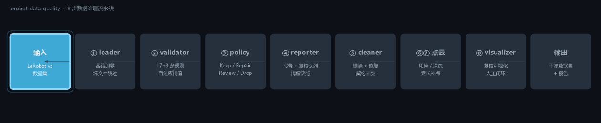

# LeRobot 数据质量治理流水线


本地 LeRobot 数据集的质检、分级处置、报告、清洗与可视化工具。支持 v3.0 和 v2.1 布局，输入 parquet + mp4（可选点云），输出可训练的数据集、逐 episode 的报告和可复核的队列。仓库里没有训练代码。



## 背景

机器人模仿学习对数据质量很敏感。一段 112 帧里混着 11 帧 NaN 的 episode 会让训练直接崩溃；遥操作接管产生的 action 跳变会污染归一化统计；视频和 state 差几帧时训练管线不会报错，只是安静地学到错位数据。采集中断、控制环丢包、镜头遮挡、合并时重复入库，这些在真实数据里都会出现。LeRobot 官方工具链负责加载和编辑，本身没有质检层。

社区里的 `lerobot-doctor` 和 DataDoctor 做的是巡检，检查项比本项目全（本项目也没有 URDF）。差别在判定之后：它们给出 PASS / WARN / FAIL，本项目把规则判不了的样本放进复核队列，人工裁决通过 `--overrides` 回灌，清洗产物写到独立目录，不碰源数据。逐项对照见 [docs/COMPARISON.md](docs/COMPARISON.md)。

## 快速开始

```bash
git clone https://github.com/15389065619/lerobot-data-quality && cd lerobot-data-quality
pip install -e .                                   # 安装依赖与 lerobot-data-quality 命令
python tools/make_demo_dataset.py                   # 生成含 13 处注入异常的演示集
lerobot-data-quality --dataset_path demo_dataset --output_dir outputs
```

运行后生成 `outputs/quality_report.json`、`outputs/review_queue.csv`、`outputs/cleaned_dataset/` 和 `outputs/plots/`。[`examples/`](examples) 是这次运行的快照。

完整链路（质检 → 清洗 → 版本 → 卡片）：

```bash
python tools/demo.py --force
```

比单次运行多两份产物：`outputs/demo/DATASET_CARD.md`（数据集卡片）和清洗产物的内容寻址快照（末尾做一次 dry-run 回滚演练）。

Docker：

```bash
docker build -t lerobot-data-quality .
docker run --rm \
  -v /path/to/dataset:/data:ro \
  -v /path/to/outputs:/outputs \
  lerobot-data-quality --dataset_path /data --output_dir /outputs
```

## 设计决策

| 问题 | 做法 |
|---|---|
| 不同机器人关节单位不同，绝对阈值必然误报 | 阈值自适应：帧数区间 median ± k·MAD，action 跳变逐维 median\|Δ\| + k·1.4826·MAD\|Δ\|，配置 floor 只是安全下限 |
| 有异常就删会浪费可救数据 | keep / repair / review / drop 四档：demo 注入 13 处异常，一刀切要删 12 处，实际删 7 处 |
| 自动判定不能终审 | review 结论导出 `review_queue.csv`（带视频路径与证据），人工填写后 `--overrides` 回灌，覆盖判定并留痕 |
| 并发不能改变结论 | worker 是纯函数不写盘，主进程统一落盘，并发结果与串行逐位一致（有测试钉住） |
| 结论要能事后追溯 | 报告带数据集结构指纹、配置与自适应阈值快照、修复动作清单，两次运行可 diff |

完整权衡见 [ARCHITECTURE.md](ARCHITECTURE.md)。

## 示例输出

| 帧数分布（正常/异常分色） | 处置结果占比 |
|---|---|
|  |  |

终端报告（demo_dataset 实测）：

```
正常 23 (63.9%)    异常 13    健康度: 严重（先修采集流程）
  - nan_state                  3 个 episode
  - action_jump                3 个 episode
  - frame_mismatch             1 个 episode
  - blank_video                1 个 episode
  - duplicate_episode          1 个 episode
数据集级问题 [stats_stale] meta/stats.json 与实测数据偏差过大（归一化统计已过期）

保留 24   修复 2   复核 3   剔除 7
  ep    5  error    repair  裁掉首3帧/尾0帧后保留
  ep    7  warning  review  人工复核后决定
  ep   15  warning  repair  用 frame_index/fps 重建时间轴

预计保留    : 29 个 episode, 2393 帧（丢弃 612 帧，裁帧 3 帧）
```

## 规则

质检按「证据强度 × 可修复性」给出处置，节选（19 条 episode 级、4 条数据集级、8 条点云规则的完整判据见 [ARCHITECTURE.md §7](ARCHITECTURE.md)）：

| 规则 | 级别 | 处置 | 说明 |
|---|---|---|---|
| `nan_state` / `nan_action` | error | drop / trim | NaN/Inf。只出现在首尾时可以裁剪保留，中段则丢弃 |
| `action_jump` | warning | review | 逐维阈值取自每集最大跳变的稳健包络，步进保持和度制数据不误报；超阈 <1.5 倍降为 info（边缘命中多是快速但连续的正常动作） |
| `timestamp_not_monotonic` | warning | repair | 用 frame_index/fps 重建时间轴 |
| `frame_mismatch` | error | drop | 视频帧数不等于 state 行数（±1 帧容差）；meta 给不出定位信息时降为 info（不可评估） |
| `static_episode` | error | drop | 空转 episode，无效采集 |
| `meta_episode_mismatch`（数据集级） | warning | repair | meta 用全局 ID、data 用 0..N-1 时按顺序映射，行数与视频窗口双重校验 ≥99% 才接受；证据不足标为不可评估，不剔除 |

严重度和阈值可在 `config/default.yaml` 按 robot_type 覆盖（`robots: {so100_follower: {...}}`）。

## 3D 点云质检与清洗

针对 `observation.environment_state` 这类 `[N, D]`（D≥3，通常是 xyz+RGB）二维点云特征。它不进主 DataFrame，按 parquet batch 流式读取，18374 帧 / 512 点只需几十 MB 常驻内存。8 条规则（非有限值、稀疏、退化、重复、离群、越界、颜色、帧间突变）的判据见 [ARCHITECTURE.md §7](ARCHITECTURE.md)。

修复约定：过滤非有限点 → 去离群 → 去重 → 颜色裁剪 → 抖动重采样补回固定点数，修复后仍是 N 点 × D 维（Array2D 契约）。不可修复的帧不删行，用同 episode 最近好帧占位（hold-last-good），保证行数与视频、state 对齐。可修复坏点占比超过 `max_repair_ratio`（默认 35%）判 drop，不用抖动点大规模伪造几何。

点云阶段在清洗产物上原地 patch（episode 可能被重编号）；跳过或清洗失败时退回源数据集只读，独立输出到 `outputs/pointcloud_cleaned/`。

## 上游数据源适配

`src/lerobot_data_quality/` 附带三个可选适配器，与 `pipeline/` 主线零依赖，不用则行为不变。输出与 LeRobot 帧表同构，缺陷不在加载层裁决：NaN、丢帧、时间戳缺口原样进帧表，交给下游规则统一标记。

- **ROS Bag**：rosbags 纯 Python 解析 `.bag` / rosbag2 / `.mcap`（无需 ROS 环境），`/joint_states` 与相机 topic 最近邻对齐到同一时间轴。`pip install lerobot-data-quality[rosbag]`
- **FZMotion 动捕 CSV**：长表（timestamp, marker_id, x, y, z）转宽表帧表，缺 marker 补 NaN
- **MotionDecode（青瞳视觉）G1 轨迹 CSV**：宽表（root 位姿 + 29 DOF，无显式时间戳）转帧表，120 FPS 按 frame_index/fps 补时间戳

```python
from lerobot_data_quality.loaders import RosbagAdapter

df = RosbagAdapter("examples/rosbag_sim/episode_000.bag").to_dataframe()
# 乱序排序恢复、重复时间戳去重（均留 warning）；相机丢帧窗口的 camera_timestamp 为 NaN，缺口不插值
```

其余用法见各适配器 docstring 与 `examples/`。

## 其他能力

### Web Dashboard

```bash
python tools/dashboard_server.py --dataset_path demo_dataset --output_dir outputs --open
```

左侧按处置档位过滤 episode，右侧看 action / state 多维曲线与视频片段（支持拖动预览）。纯标准库 `http.server`，不引入 Web 框架。

### 训练前预检

```python
# train.py
from pipeline.precheck import precheck, DirtyDatasetError

def train(dataset_path):
    precheck(dataset_path, strict=True)   # 有 drop 级 episode 就抛异常，避免白跑一次训练
    ...
```

只读，不写数据集；退出码 0 通过 / 2 阻断，可接 CI。已知边界：预检与 `--streaming` 一样不把逐帧表读进内存，`meta/episodes` 缺 `tasks` 列的数据集（如 `lerobot/libero`）会整批判 `missing_task`——判 review 不判 drop，不会删数据，但结论以全量模式为准，见 [docs/EVAL.md §2.5](docs/EVAL.md) M1。

### 数据集版本管理

```bash
python -m pipeline.versions --dataset_path data/gym_xarm commit --note "清洗前基线"
python -m pipeline.versions --dataset_path data/gym_xarm restore --version <v1> [--apply]
```

内容寻址存储，同一文件多版本只存一份；增量快照不重读未变文件。回滚默认 dry-run，缺对象直接拒绝，不做部分恢复。

### 修复策略学习

```bash
python -m pipeline.tuning --report outputs/quality_report.json \
    --reviews outputs/review_queue_reviewed.csv --out config/tuned.yaml
```

按规则统计人工剔除率（≥80% 建议升 error，≤20% 建议降 info），对带数值证据的规则做可分离性分析。只输出 YAML patch，人工评审后才合并进配置，不静默生效。

## 安装与运行

```bash
python -m venv .venv
.venv/Scripts/pip install -r requirements.txt          # Windows
.venv/Scripts/pip install -r requirements-dev.txt      # 开发/测试
python -m pytest tests                                  # 334 个单测
```

未上传 PyPI，用 `pip install -e .` 从源码安装（提供 `lerobot-data-quality` 等 console 命令）。

```bash
# 基础用法
python main.py --dataset_path path/to/dataset --output_dir outputs

# 只体检前 20 个 episode（调试大数据集）
python main.py --dataset_path demo_dataset --output_dir outputs --max_episodes 20

# 人工复核后回灌（第二次运行）
python main.py --dataset_path demo_dataset --output_dir outputs_run2 --overrides outputs/review_queue_reviewed.csv

# 流式模式：按 parquet 分片扫描，不把逐帧表读进内存（大数据集；暂不支持清洗）
# 结论可能与全量不同：缺 tasks 列的数据集会整批误判 missing_task，见 docs/EVAL.md §2.5 M1
python main.py --dataset_path big_dataset --output_dir outputs --streaming
```

增量模式复用的结论与全量逐位一致（manifest 缓存完整结论，含 severity_overrides）。

| 参数 | 默认 | 说明 |
|---|---|---|
| `--dataset_path` / `--output_dir` | 必填 / `outputs` | 数据集根目录 / 输出根目录 |
| `--max_episodes` | 全量 | 只处理前 N 个 episode |
| `--config` | 内置默认 | 策略配置 YAML/JSON（按 robot_type 覆盖阈值） |
| `--overrides` | 无 | 人工复核结果 CSV |
| `--on-review` | `keep` | 未经复核的 warning 如何处置（keep/drop） |
| `--workers` | 1 | 并发进程数（只作用于质检阶段） |
| `--skip-clean` / `--skip-plots` / `--no-cli` | 关 | 跳过对应阶段 / 禁用官方 CLI |
| `--skip-pointcloud` / `--pointcloud-feature` / `--pointcloud-overrides` | 关 / 自动识别 / 无 | 点云阶段开关、列名指定与复核回灌 |
| `--incremental` / `--manifest` / `--force` | 关 / `quality_manifest.json` / 关 | 增量模式、状态文件路径、忽略缓存强制重跑 |
| `--streaming` | 关 | 流式分片扫描，自动跳过清洗（已知边界见上） |
| `--min-frames` / `--max-frames` / `--action-jump-threshold` | 自适应 | 快捷固定阈值（切换到 fixed 模式） |

没有数据时，`python tools/make_demo_dataset.py` 会生成一份含 13 处注入异常的演示集。

## 输出说明

```
outputs/
├── quality_report.json      # 指纹、阈值快照、逐 episode 明细（帧号级证据）、
│                            #   处置统计、数据集级问题、归因分析、建议
├── quality_manifest.json    # 增量模式状态：episode 指纹、阈值快照、清洗产出缓存
├── review_queue.csv         # 人工复核队列：填 reviewer_disposition 后可 --overrides 回灌
├── pointcloud_report.json   # 点云质检：自适应阈值、逐帧处置、证据、修复动作、前后对比样本
├── pointcloud_review_queue.csv  # 点云复核队列：填 reviewer_disposition 后可 --pointcloud-overrides 回灌
├── cleaned_dataset/         # 清洗后数据集：删除 + 修复、索引重映射归零、视频按时间窗重建、
│                            #   stats 重算、点云原地 patch、meta/*_cleaning_notes.json 留痕
├── pointcloud_cleaned/      # 仅当没有清洗产物时生成：点云独立清洗输出（源数据集保持只读）
├── plots/                   # 帧数分布 / 占比 / 关节曲线 / action 散点 / 清洗前后对比
└── intermediate/            # 各阶段中间结果（01~07），任一步中断均可复用
```

源数据集严格只读：输出目录不能等于或位于源数据集内部，也不能反过来包含源数据集，否则发布时清理旧产物会连带删掉源目录。CLI 入口和清洗器各有一道判断，都有单测。

## 实测摘要

| 场景 | 数据 | 结论 |
|---|---|---|
| demo_dataset | 36 ep / 3008 帧 | 13 处注入异常全命中（覆盖 12 类规则），0 误报；默认策略保留 24 / 修复 2 / 复核 3 / 剔除 7，清洗产物 29 ep / 2393 帧；归因定位到采集人（bob 44.4% vs alice 27.8%） |
| 真实点云数据集 | 50 ep / 18374 帧 | 8 步全跑通；点云 18374 帧全正常；故障注入 8 类规则全命中，修复后行数、点数、schema 全不变 |
| 并发 | 同上 | `--workers 8`：190.1 s → 64.7 s（2.9×），产物与串行逐字节一致 |
| 容错与续传 | 人为损坏 1 个分片 | 不中断（23 episode 标 `episode_read_error`）；二跑 1.6 s；修复后自动重扫恢复 |
| 真实数据集编号错位 | behavior1k_task0042：14 GB / 200 ep / 128 万帧 | meta 全局 ID 对 data 0..N-1，修复前 200/200 error、建议删光；自动对齐后保留 195 / 复核 5 / 剔除 0，实测视频与 state 逐条对齐 |
| 19 个数据集审计 | v3.0 / v2.1 混合，5855 ep | 17 个仓库原有 + 2 份 HF 公开集。本地轮查出 3 处工具缺陷和 3 处数据真实缺陷；外部集又推翻 4 条结论（流式/预检/复检三路径 `missing_task` 假阳性、`stats_stale` 采样偏差等），详见 [docs/EVAL.md §2.3 与 §2.5](docs/EVAL.md) |
| 清洗收益（代理指标） | demo + behavior1k | demo：动作方差 −10.0%，归一化跳变 51.1 → 0.34；真实规模：方差只降 1.2%（全部来自删样本），跳变 −25.7%。方差对边缘命中不敏感，能稳定观测的是跳变指标。未训练模型，不声称精度提升，见 [docs/EVAL.md §9–§11](docs/EVAL.md) |

详细数字、注入表和边界说明见 [docs/EVAL.md](docs/EVAL.md)。下游行数字由 `tools/analyze_action_distribution.py` 复算生成，`--update-eval` 幂等写回文档；大数据集可用 `--proxy-from-kept` 省掉数小时视频重编码。

## 快速导航

| 文档 | 内容 |
|---|---|
| [ARCHITECTURE.md](ARCHITECTURE.md) | 架构设计说明书：设计决策与权衡、编号对齐案例、扩展性；§7 附全部规则与 Schema 契约表 |
| [SOURCE_WALKTHROUGH.md](SOURCE_WALKTHROUGH.md) | 逐模块源码走读：按 main.py 执行顺序讲解每个文件的职责与关键实现 |
| [docs/COMPARISON.md](docs/COMPARISON.md) | 对照同生态质检工具与上下游工具链，含选型建议 |
| [docs/EVAL.md](docs/EVAL.md) | 全量实测记录、故障注入表、已知边界 |
| [docs/POSTMORTEM.md](docs/POSTMORTEM.md) | 四次判定错误复盘：现象 → 怀疑 → 证据证伪 → 修复 → 防回归用例 |

## 技术栈

pandas + pyarrow（清洗直接操作 Arrow 表，保住 `fixed_size_list` / `Array2D` schema；点云按 batch 流式读写）、ffprobe/ffmpeg（帧探针与视频重建）、matplotlib（可视化）、pytest（334 个单测，分支覆盖率实测 74%，CI 强制 64% 门槛）、GitHub Actions（3.10/3.11/3.12 三版本矩阵）。不强依赖 lerobot 包；安装了 lerobot 时，纯删除场景优先走官方 `lerobot-edit-dataset` CLI，存在修复项时强制走内置实现（官方 CLI 只能删不能修）。

## 数据集格式（LeRobot v3.0）

```
dataset/
├── data/chunk-000/file-000.parquet          # 多 episode 合并存储
├── meta/info.json, stats.json, tasks.parquet
├── meta/episodes/chunk-000/file-000.parquet # length、tasks、视频 chunk/file/from/to_timestamp
└── videos/<camera>/chunk-000/file-000.mp4   # 多 episode 拼接，按时间窗切分
```

兼容 v2.1 布局（episode-per-file、episodes.jsonl、tasks.jsonl）。
