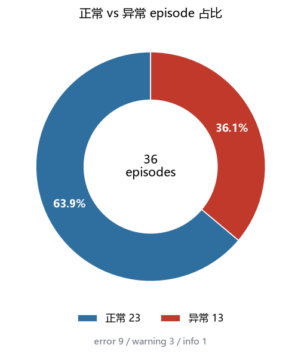

# LeRobot 数据质量治理流水线


[](https://opensource.org/licenses/Apache-2.0)

本地 LeRobot 数据集的质检、分级处置、报告、清洗与可视化工具。支持 v3.0 / v2.1 布局，输入 parquet + mp4（可选点云），输出可训练数据集、逐 episode 报告与可复核队列。仓库不含训练代码。

> 面向机器人模仿学习的数据治理引擎：不训练模型，只回答三个问题——这份数据能不能训、怎么修、修完值多少。

## 核心能力

**1. Core Engine — 单机可跑、内存可控**

- 自适应阈值（median ± k·MAD）与四档处置 keep / repair / review / drop，能用修复解决的不删数据
- `--streaming` 按 parquet 分片扫描，逐帧表不驻留内存；点云按 batch 流式处理
- L0 预检（秒级）与 L1 全量质检分级拦截；`precheck()` 可接 CI（退出码 0 通过 / 2 阻断）
- 并发结论与串行逐位一致；`--incremental` 用 manifest 复用已算结论

**2. High Extensibility — 与主线零依赖的适配层**

- `adapters/`：ROS Bag（`.bag` / rosbag2 / `.mcap`）、FZMotion 动捕 CSV、MotionDecode G1 轨迹 CSV
- `verticals/gait_unit/`：光捕第二产线（两级 IR + 三层 Tier + LAFAN1 校准），独立演进
- 适配器只负责把异构数据读成帧表，缺陷统一交下游规则裁决

**3. Closed-loop Evaluation — 结论用实验说话**

- Kaggle 训练 SmolVLA 做 A/B：完整清洗臂 vs 最小修复臂，同 epoch 差 −0.021（t=−5.45）
- 多 seed 三臂复验（−0.0199 ± 0.0023）与窗口级 DiD（−0.046，t=−3.76）交叉验证
- 实验推翻了"结构异常就该丢弃"的初始政策，改为 repair-not-drop

**4. Dynamic Trade-off — 处置随数据规模切换**

同一条结构错位（meta 多段 take、视频窗口漂移、时间轴/索引不一致）在不同体量下的最优处置并不相同：

- **中小规模（实验验证区间）**：默认 `repair`。这类样本的 (state, action) 监督对仍然有效，整集丢弃会损失稀缺的多样性——A/B 实验显示被 drop 的窗口确实携带可学习信号（DiD = −0.046，t = −3.76）。
- **TB 级规模**：重编码的算力开销与 PTS 偏移风险随文件数放大，逐集修复的边际收益递减。可通过 `defaults.scale_policy` 设定帧数阈值（默认 1,000,000 帧），将重度结构损坏自动降级为 `drop`，在治理成本与模型收益之间取得更优 ROI。
- 策略由 `enable` / `min_frames_threshold` / `action_on_large` / `action_on_small` 控制；策略关闭或总帧数未知时回退原有 `repair`，不改变旧配置行为。


## 快速开始

```bash
git clone https://github.com/15389065619/lerobot-data-quality && cd lerobot-data-quality
pip install -e .                                   # 安装依赖与 lerobot-data-quality 命令
python tools/make_demo_dataset.py                   # 生成含 13 处注入异常的演示集
lerobot-data-quality --dataset_path demo_dataset --output_dir outputs
```

运行后生成 `outputs/quality_report.json`、`outputs/review_queue.csv`、`outputs/cleaned_dataset/` 与 `outputs/plots/`；[`examples/`](examples) 是本次运行的快照。完整链路（质检 → 清洗 → 版本 → 卡片）用 `python tools/demo.py --force`，额外产出 `DATASET_CARD.md` 与内容寻址快照（含一次 dry-run 回滚演练）。

Docker：

```bash
docker build -t lerobot-data-quality .
docker run --rm -v /path/to/dataset:/data:ro -v /path/to/outputs:/outputs \
  lerobot-data-quality --dataset_path /data --output_dir /outputs
```

## 示例输出

| 帧数分布（正常/异常分色） | 处置结果占比 |
|---|---|
|  |  |

终端报告（demo_dataset 实测）：

```
正常 23 (63.9%)    异常 13    健康度: 严重（先修采集流程）
  - nan_state 3 / action_jump 3 / frame_mismatch 1 / blank_video 1 / duplicate_episode 1
数据集级问题 [stats_stale] meta/stats.json 与实测数据偏差过大（归一化统计已过期）

保留 24   修复 2   复核 2   剔除 8
  ep    5  error    repair  裁掉首3帧/尾0帧后保留
  ep    7  warning  review  人工复核后决定
  ep   15  warning  repair  用 frame_index/fps 重建时间轴

预计保留 : 28 个 episode, 2388 帧（丢弃 617 帧，裁帧 3 帧）
```

## 规则

质检按「证据强度 × 可修复性」给出处置，节选（19 条 episode 级、4 条数据集级、8 条点云规则的完整判据见 [ARCHITECTURE.md §7](ARCHITECTURE.md)）：

| 规则 | 级别 | 处置 | 说明 |
|---|---|---|---|
| `nan_state` / `nan_action` | error | drop / trim | NaN/Inf。只出现在首尾时可裁剪保留，中段则丢弃 |
| `action_jump` | warning | review | 逐维阈值取自每集最大跳变的稳健包络；超阈 <1.5 倍降为 info |
| `timestamp_not_monotonic` | warning | repair | 用 frame_index/fps 重建时间轴 |
| `frame_mismatch` | error | repair / review | 视频帧数 ≠ state 行数（±1 帧容差，多段按段计量）；可收窄窗口时 repair，定位信息不足时降为 info |
| `static_episode` | error | drop | 空转 episode，无效采集 |
| `meta_episode_mismatch`（数据集级） | warning | repair | meta 全局 ID 对 data 0..N-1 时按顺序映射，行数与视频窗口双重校验 ≥99% 才接受 |

严重度与阈值可在 `config/default.yaml` 按 robot_type 覆盖（`robots: {so100_follower: {...}}`）。结构错位类规则的 repair/drop 还会受 `defaults.scale_policy` 的规模阈值控制（见核心能力 4）。

## 实测摘要

| 场景 | 数据 | 结论 |
|---|---|---|
| demo_dataset | 36 ep / 3008 帧 | 13 处注入异常全命中（12 类规则），0 误报；保留 24 / 修复 2 / 复核 2 / 剔除 8，清洗产物 29 ep / 2393 帧；归因定位到采集人 |
| 真实点云数据集 | 50 ep / 18374 帧 | 8 步全跑通；8 类故障注入全命中，修复后行数、点数、schema 全不变 |
| 并发 | 同上 | `--workers 8`：190.1 s → 64.7 s（2.9×），产物与串行逐字节一致 |
| 容错与续传 | 人为损坏 1 个分片 | 不中断（23 ep 标 `episode_read_error`）；二跑 1.6 s，修复后自动重扫恢复 |
| 真实数据集编号错位 | behavior1k：14 GB / 200 ep / 128 万帧 | 修复前 200/200 error、建议删光；自动对齐后保留 195 / 复核 5 / 剔除 0 |
| 19 个数据集审计 | v3.0 / v2.1 混合，5855 ep | 轮查出 3 处工具缺陷与 3 处数据真实缺陷；外部集推翻 4 条结论，详见 [docs/EVAL.md §2.3 / §2.5](docs/EVAL.md) |
| Kaggle A/B 训练 | so101_bomb：A 157 块 vs B′ 106 集，SmolVLA | A 显著更优（−0.021，t=−5.45）；multi-seed −0.0199 ± 0.0023；badgood DiD = −0.046 ± 0.012（t=−3.76）。详见 [results.md](evaluation/kaggle_ab/results.md) |
| 光捕泛化 + 注入基准 | chingmu 20 集 + 古典舞 18 集；LAFAN1 77 段 × 385 注入 | dance 跨域可用（报警率 33.5 vs 33.6/36.8‰），jumps 有 14 倍域偏差；注入 precision 全 15 类 1.0。详见 [docs/EVAL.md §12–§13](docs/EVAL.md) |

清洗收益只报可复现的代理指标（demo 动作方差 −10.0%、归一化跳变 51.1 → 0.34；真实规模跳变 −25.7%），不声称精度提升，见 [docs/EVAL.md §9–§11](docs/EVAL.md)。

## 更多能力

| 能力 | 说明 |
|---|---|
| 3D 点云 | `[N, D]`（D≥3）特征按 batch 流式质检 + 清洗：8 条规则、Array2D 契约、不可修复帧 hold-last-good 占位、清洗产物原地 patch，详见 [ARCHITECTURE.md §7](ARCHITECTURE.md) |
| 数据源适配 | `adapters/` 三个零依赖适配器把 ROS Bag / FZMotion CSV / MotionDecode G1 轨迹读成帧表，缺陷不在加载层裁决 |
| 光捕第二产线 | `verticals/gait_unit/`：两级 IR、三层 Tier、LAFAN1 全库校准表与 385 次注入基准 |
| Web Dashboard | `python ui/dashboard_server.py --dataset_path ... --open`，纯标准库 `http.server`，按档位过滤 + 多维曲线 + 视频拖动预览 |
| 训练前预检 | `precheck(path, strict=True)` 只读拦截，有 drop 级 episode 直接抛 `DirtyDatasetError` |
| 版本管理 | `python -m pipeline.versions commit/restore`，内容寻址、增量快照、回滚默认 dry-run |
| 修复策略学习 | `python -m pipeline.tuning` 按人工复核率给出 YAML patch，人工评审后才合并 |

## 安装与常用命令

```bash
python -m venv .venv
.venv/Scripts/pip install -r requirements.txt          # Windows
.venv/Scripts/pip install -r requirements-dev.txt      # 开发/测试
python -m pytest tests                                 # 440 个单测

python main.py --dataset_path path/to/dataset --output_dir outputs
python main.py --dataset_path demo_dataset --output_dir outputs --max_episodes 20
python main.py --dataset_path demo_dataset --output_dir outputs_run2 \
    --overrides outputs/review_queue_reviewed.csv
python main.py --dataset_path big_dataset --output_dir outputs --streaming
```

未上传 PyPI，用 `pip install -e .` 从源码安装。`--streaming` 下 meta 缺 `tasks` 列的数据集会整批判 `missing_task`（review 不 drop，结论以全量模式为准），见 [docs/EVAL.md §2.5](docs/EVAL.md) M1。

| 参数 | 默认 | 说明 |
|---|---|---|
| `--dataset_path` / `--output_dir` | 必填 / `outputs` | 数据集根目录 / 输出根目录 |
| `--config` | 内置默认 | 策略 YAML/JSON（含 `scale_policy`、按 robot_type 覆盖） |
| `--overrides` | 无 | 人工复核结果 CSV 回灌 |
| `--workers` | 1 | 并发进程数（仅质检阶段） |
| `--streaming` | 关 | 流式分片扫描，自动跳过清洗 |
| `--incremental` / `--force` | 关 | 增量复用 / 忽略缓存强制重跑 |
| `--skip-clean` / `--skip-plots` / `--no-cli` | 关 | 跳过对应阶段 / 禁用官方 CLI |
| `--min-frames` / `--max-frames` / `--action-jump-threshold` | 自适应 | 快捷固定阈值 |
| `--pointcloud-feature` / `--pointcloud-overrides` | 自动 / 无 | 点云列名与复核回灌 |

## 输出说明

```
outputs/
├── quality_report.json      # 指纹、阈值快照、逐 episode 帧号级证据、处置统计、数据集级问题
├── quality_manifest.json    # 增量状态：episode 指纹、阈值快照、清洗产出缓存
├── review_queue.csv         # 复核队列：填 reviewer_disposition 后 --overrides 回灌
├── pointcloud_report.json / pointcloud_review_queue.csv
├── cleaned_dataset/         # 删除 + 修复、索引重映射、视频重建、stats 重算、notes 留痕
├── plots/                   # 帧数分布 / 占比 / 关节曲线 / action 散点 / 清洗前后对比
└── intermediate/            # 各阶段中间结果（01~07），中断可复用
```

源数据集严格只读：输出目录与源数据集不能互相包含，否则发布清理旧产物会连带删除源目录（CLI 与清洗器各有一道判断，并有单测）。

## 文档导航

| 文档 | 内容 |
|---|---|
| [ARCHITECTURE.md](ARCHITECTURE.md) | 架构设计、权衡、编号对齐案例；§7 附全部规则与 Schema 契约 |
| [SOURCE_WALKTHROUGH.md](SOURCE_WALKTHROUGH.md) | 按 main.py 执行顺序的逐模块源码走读 |
| [docs/COMPARISON.md](docs/COMPARISON.md) | 与同生态质检工具的逐项对照与选型建议 |
| [docs/EVAL.md](docs/EVAL.md) | 全量实测记录、故障注入表、已知边界 |
| [docs/POSTMORTEM.md](docs/POSTMORTEM.md) | 四次判定错误复盘（现象 → 证伪 → 修复 → 防回归） |

## 技术栈与格式

pandas + pyarrow（直接操作 Arrow 表，保住 `fixed_size_list` / `Array2D` schema）、ffprobe/ffmpeg、matplotlib、pytest（440 个单测，分支覆盖率实测 78%，CI 门槛 64%）、GitHub Actions（3.10/3.11/3.12）。不强依赖 lerobot 包；纯删除场景优先走官方 `lerobot-edit-dataset`，存在修复项时强制走内置实现。

```
dataset/
├── data/chunk-000/file-000.parquet          # 多 episode 合并存储
├── meta/info.json, stats.json, tasks.parquet
├── meta/episodes/chunk-000/file-000.parquet # length、tasks、视频 chunk/file/from/to_timestamp
└── videos/<camera>/chunk-000/file-000.mp4   # 多 episode 拼接，按时间窗切分
```

兼容 v2.1 布局（episode-per-file、episodes.jsonl、tasks.jsonl）。

## 许可证

本项目采用 [Apache License 2.0](LICENSE)。
