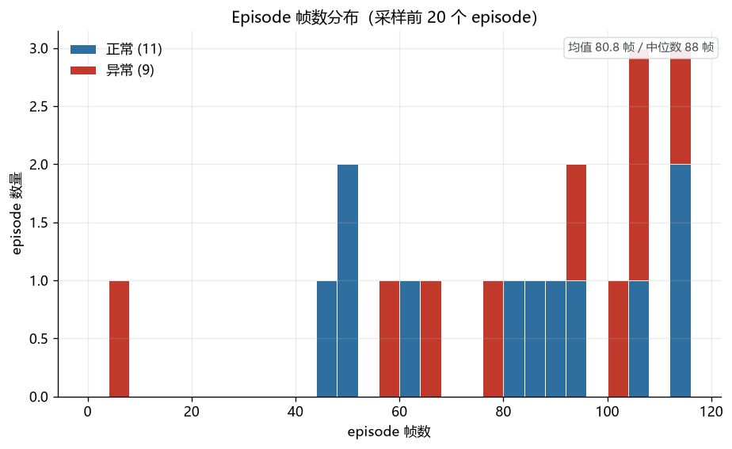

# LeRobot 数据质量治理流水线


[](https://opensource.org/licenses/Apache-2.0)

面向机器人模仿学习的数据治理引擎。它不训练模型，只回答三个问题：**这份数据能不能训、怎么修、修完值多少。**

输入本地 LeRobot 数据集（v3.0 / v2.1 布局：parquet + mp4，可选点云），输出清洗后的数据集、逐 episode 报告与可复核队列。源数据严格只读，仓库不含训练代码。

## 核心能力

- **Core Engine** — 自适应阈值（median ± k·MAD）与四档处置 keep / repair / review / drop，能用修复解决的不删；`--streaming` 按 parquet 分片扫描、点云按 batch 流式处理，逐帧表不驻留内存；并发结论与串行逐位一致，`--incremental` 复用已算结论；`precheck()` 可接 CI
- **High Extensibility** — `adapters/`（ROS Bag / FZMotion / MotionDecode）与 `verticals/gait_unit/`（光捕第二产线）同主线零依赖；适配器只把异构数据读成帧表，缺陷统一交下游规则裁决
- **Closed-loop Evaluation** — Kaggle 训 SmolVLA 做 A/B：最小修复臂优于完整清洗臂（同 epoch −0.021，t=−5.45），多 seed 复验 −0.0199 ± 0.0023；窗口级 DiD（−0.046，t=−3.76）说明被 drop 的窗口仍携带可学习信号，处置政策据此改为 repair-not-drop
- **Dynamic Trade-off** — 结构错位（多段 take、视频窗口漂移、时间轴/索引不一致）在小数据集上默认 repair 以保住多样性；总帧数超过 `defaults.scale_policy` 阈值（默认 100 万帧）时改判 drop，因为重编码的算力开销与 PTS 偏移风险随规模放大


## 快速开始

```bash
git clone https://github.com/15389065619/lerobot-data-quality && cd lerobot-data-quality
pip install -e .
python tools/make_demo_dataset.py                                  # 生成含 13 处注入异常的演示集
lerobot-data-quality --dataset_path demo_dataset --output_dir outputs
```

演示集 36 个 episode / 3008 帧，一次运行的结论：

```
正常 24 (66.7%)    异常 12    健康度: 严重（先修采集流程）
处置建议    : 保留 25 / 修复 2 / 复核 2 / 剔除 7
预计保留    : 29 个 episode, 2393 帧（丢弃 612 帧，裁帧 3 帧）
```

| 帧数分布（正常/异常分色） | 处置结果占比 |
|---|---|
|  |  |

产物写入 `outputs/`：

| 文件 | 内容 |
|---|---|
| `quality_report.json` | 逐 episode 帧号级证据、阈值快照、处置统计、归因与建议 |
| `review_queue.csv` | 复核队列，填 `reviewer_disposition` 后用 `--overrides` 回灌 |
| `cleaned_dataset/` | 清洗后数据集：删除 + 修复、索引重映射、视频重建、stats 重算 |
| `plots/` | 帧数分布、处置占比、关节曲线、清洗前后对比 |

[`examples/`](examples) 里存着一份样例产物。`python tools/demo.py --force` 跑完整链路（质检 → 清洗 → 版本快照 → 数据卡片），额外产出 `DATASET_CARD.md` 并做一次 dry-run 回滚演练。

Docker：

```bash
docker build -t lerobot-data-quality .
docker run --rm -v /path/to/dataset:/data:ro -v /path/to/outputs:/outputs \
  lerobot-data-quality --dataset_path /data --output_dir /outputs
```

## 处置与规则

每条 episode 按「证据强度 × 可修复性」落到四档之一：

| 处置 | 含义 | 演示集里的例子 |
|---|---|---|
| keep | 正常，或只记录不改数据 | timestamp 步长抖动 |
| repair | 修好后保留 | 首尾 NaN 裁帧、时间轴重建 |
| review | 机器判不了，交人工 | 过短的 episode、任务描述缺失 |
| drop | 硬损坏 | 中段 NaN/Inf、黑屏、空转、重复采样、视频截断 |

严重度与阈值可在 `config/default.yaml` 按 robot_type 覆盖；结构错位类的 repair / drop 另受 `scale_policy` 规模阈值控制。全部规则（episode 级 / 数据集级 / 点云）与判据见 [ARCHITECTURE.md §7](ARCHITECTURE.md)。

## 实测摘要

| 场景 | 结论 |
|---|---|
| demo_dataset（36 ep / 3008 帧） | 注入 13 处异常命中 12 处，0 误报；清洗后 29 ep / 2393 帧 |
| 真实数据集编号错位（behavior1k，14 GB / 200 ep） | 修复前 200/200 error、建议删光；自动对齐后保留 195 / 复核 5 / 剔除 0 |
| Kaggle A/B（SmolVLA） | 最小修复臂 A 显著优于完整清洗臂 B′：−0.021（t=−5.45），multi-seed −0.0199 ± 0.0023，DiD −0.046（t=−3.76），详见 [results.md](evaluation/kaggle_ab/results.md) |
| 光捕（gait_unit） | LAFAN1 77 段校准 + 385 次注入基准，precision 全类别 1.0；跨域泛化按动作类别分化 |

点云、并发、容错续传、19 个数据集审计与已知边界见 [docs/EVAL.md](docs/EVAL.md)。清洗收益只报可复现的代理指标，不声称精度提升。

## 更多能力

| 能力 | 说明 |
|---|---|
| 3D 点云 | `[N, D]` 特征按 batch 流式质检 + 清洗；不可修复帧用同 episode 最近好帧占位，保持与视频、state 行对齐 |
| 数据源适配 | `adapters/`：ROS Bag（`.bag` / rosbag2 / `.mcap`，`pip install lerobot-data-quality[rosbag]`）、FZMotion 动捕 CSV、MotionDecode G1 轨迹 CSV |
| 光捕第二产线 | `verticals/gait_unit/`：两级 IR、三层 Tier 规则，LAFAN1 全库校准 |
| Web Dashboard | `python ui/dashboard_server.py --dataset_path ... --output_dir ... --open`，按档位过滤、多维曲线、视频拖动预览 |
| 训练前预检 | `precheck(path, strict=True)` 只读拦截，有 drop 级 episode 抛 `DirtyDatasetError` |
| 版本管理 | `python -m pipeline.versions commit / restore / log / diff`，内容寻址快照，回滚默认 dry-run |
| 修复策略学习 | `python -m pipeline.tuning` 按人工复核率给出 YAML patch，人工评审后才合并 |

## 常用命令

`python main.py …` 与 `lerobot-data-quality …` 等价，`--help` 看全量参数。未上传 PyPI，用 `pip install -e .` 从源码安装。

| 参数 | 默认 | 说明 |
|---|---|---|
| `--dataset_path` / `--output_dir` | 必填 / `outputs` | 数据集根目录 / 输出根目录 |
| `--config` | 内置默认 | 策略 YAML/JSON（按 robot_type 覆盖，含 `scale_policy`） |
| `--overrides` | 无 | 人工复核结果 CSV 回灌 |
| `--on-review` | `keep` | 未复核的 warning 如何处置（keep / drop） |
| `--workers` | 1 | 并发进程数（仅质检阶段） |
| `--streaming` | 关 | 流式分片扫描，自动跳过清洗；缺 `tasks` 列的数据集会误报 `missing_task`（预检同），结论以全量模式为准 |
| `--incremental` / `--force` | 关 | 增量复用 / 忽略缓存强制重跑 |
| `--skip-clean` / `--skip-plots` / `--skip-pointcloud` | 关 | 跳过对应阶段 |

开发与测试：

```bash
pip install -e .[dev]
python -m pytest tests      # 437 passed
```

CI 在 Python 3.10 / 3.11 / 3.12 上跑全量测试，分支覆盖率门槛 64%。

## 文档导航

| 文档 | 内容 |
|---|---|
| [docs/TUTORIAL.md](docs/TUTORIAL.md) | 三层讲解教程，从入门到实现 |
| [ARCHITECTURE.md](ARCHITECTURE.md) | 架构设计、权衡、编号对齐案例；§7 附全部规则与 Schema 契约 |
| [SOURCE_WALKTHROUGH.md](SOURCE_WALKTHROUGH.md) | 按 main.py 执行顺序的逐模块源码走读 |
| [docs/EVAL.md](docs/EVAL.md) | 全量实测记录、故障注入表、已知边界 |
| [docs/COMPARISON.md](docs/COMPARISON.md) | 与同生态质检工具的逐项对照与选型建议 |
| [docs/POSTMORTEM.md](docs/POSTMORTEM.md) | 四次判定错误复盘（现象 → 证伪 → 修复 → 防回归） |

## 技术栈与数据格式

pandas + pyarrow（直接操作 Arrow 表，保住 `fixed_size_list` / `Array2D` schema）、ffprobe/ffmpeg、matplotlib、pytest、GitHub Actions。不强依赖 `lerobot` 包：纯删除场景优先走官方 `lerobot-edit-dataset`，存在修复项时走内置实现。

```
dataset/
├── data/chunk-000/file-000.parquet          # 多 episode 合并存储
├── meta/info.json, stats.json, tasks.parquet
├── meta/episodes/chunk-000/file-000.parquet # length、tasks、视频 chunk/file/from/to_timestamp
└── videos/<camera>/chunk-000/file-000.mp4   # 多 episode 拼接，按时间窗切分
```

兼容 v2.1 布局（episode-per-file、`episodes.jsonl`、`tasks.jsonl`）。

## 许可证

本项目采用 [Apache License 2.0](LICENSE)。
