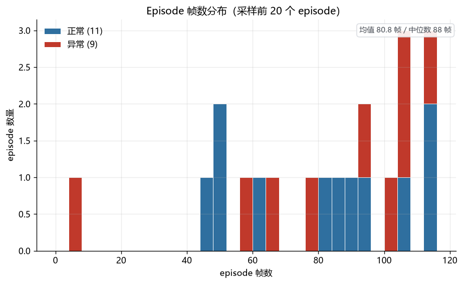
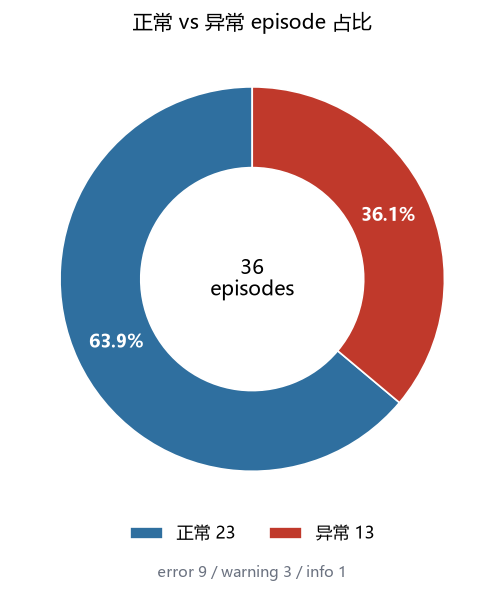
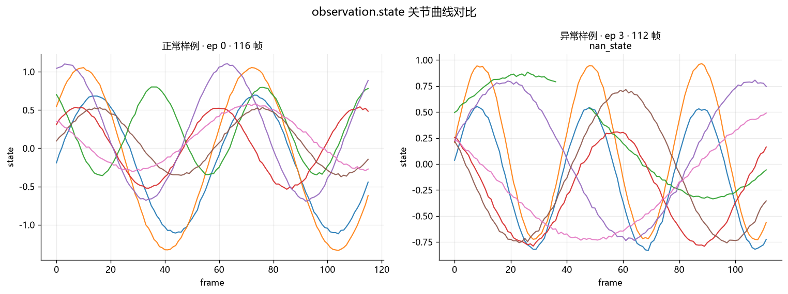
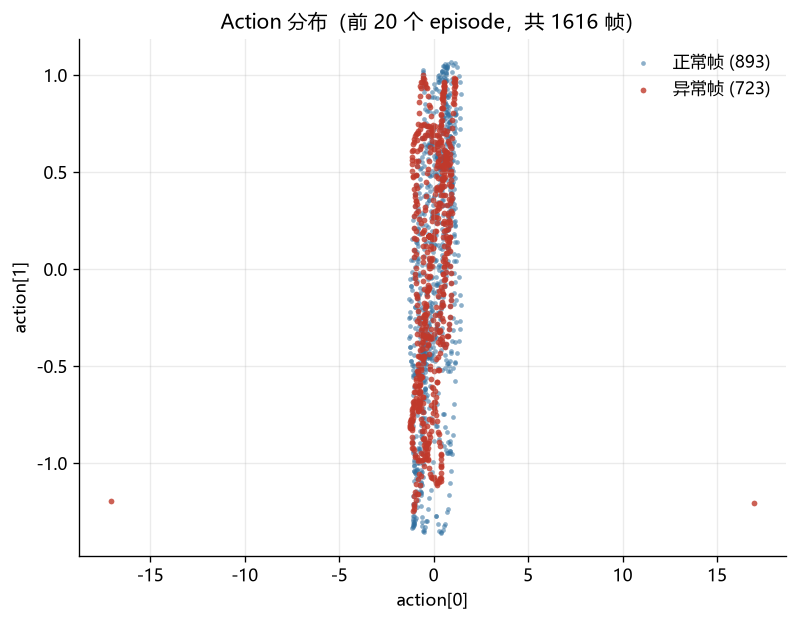
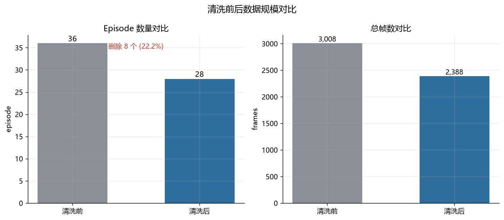

# LeRobot 数据质量校验与清洗 Pipeline

对本地 LeRobot v3 数据集做**质检 → 分级处置 → 报告 → 清洗（删除 + 修复）→ 可视化**的一站式数据治理工具。只做数据质量工程，不涉及任何训练代码。

## 解决的问题

机器人模仿学习对数据质量极其敏感：一段 112 帧里混着 11 帧 NaN 的 episode 能让训练直接崩溃；一次遥操作接管产生的 action 跳变会污染归一化统计；视频与 state 帧数错位会让训练管线**静默地**学到错位数据。这些问题在真实采集里几乎必然出现（采集中断、控制环丢包、镜头遮挡、合并时重复入库），而 LeRobot 官方工具链只有「加载」和「编辑」能力，没有质检层——本项目补的就是这一层。

## 30 秒跑通

```bash
pip install -r requirements.txt
python tools/make_demo_dataset.py --output demo_dataset --episodes 36   # 生成含 13 处注入异常的演示集
python main.py --dataset_path demo_dataset --output_dir outputs
```

产出：`outputs/quality_report.json`、`outputs/review_queue.csv`、`outputs/cleaned_dataset/`、`outputs/plots/`。本仓库的 [`examples/`](examples) 目录是这次运行的快照，可以直接点开看。

## 效果预览

| 帧数分布（正常/异常分色） | 处置结果占比 |
|---|---|
|  |  |

| 关节曲线（正常 vs 异常 episode 对照） | action 分布 |
|---|---|
|  |  |



终端报告长这样（demo_dataset 实测）：

```
正常 23 (63.9%)    异常 13    健康度: 严重（先修采集流程）
  - nan_state                  3 个 episode
  - action_jump                3 个 episode
  - frame_mismatch             1 个 episode
  - blank_video                1 个 episode
  - duplicate_episode          1 个 episode
数据集级问题 [stats_stale] meta/stats.json 与实测数据偏差过大（归一化统计已过期）

保留 24   修复 2   复核 2   剔除 8
  ep    5  error    repair  裁掉首3帧/尾0帧后保留
  ep    7  warning  review  人工复核后决定
  ep   15  warning  repair  用 frame_index/fps 重建时间轴

预计保留    : 28 个 episode, 2388 帧（丢弃 617 帧，裁帧 3 帧）
```

## 与真实业务流程对齐的设计

| 业务问题 | 本项目的做法 |
|---|---|
| 绝对阈值必然误报（不同机器人关节单位不同） | 阈值**自适应**：帧数区间 = median ± k·MAD，action 跳变逐维 = median\|Δ\| + k·1.4826·MAD\|Δ\|，配置里的 floor 只是安全下限 |
| 「有异常就删」浪费大量可救数据 | **分级处置**：keep / repair（自动修复）/ review（转人工）/ drop；时间轴错乱重建、边界坏帧裁剪、meta 索引与 stats 重算，只有不可修复的才删 |
| 质检结论必须能被人推翻 | **人工复核回路**：导出 `review_queue.csv`（带视频路径、时间窗、证据），填写后用 `--overrides` 回灌，覆盖自动判定并留痕 |
| 真正想知道的是「哪批采集有问题」 | **归因分析**：按 episodes 元数据（如采集员/日期/批次）聚合异常率，输出给上游修流程 |
| 全解码统计视频帧数在几十 GB 数据集上不可行 | 视频探针优先读容器元数据（nb_frames / duration×fps），必要时才精确解码 |
| 结论要可追溯 | 报告带**数据集指纹**（内容哈希）、**配置与自适应阈值快照**（含推导依据）、**修复动作清单**，可 diff 历次报告 |

## 质检规则（13 条）

| 规则 | 级别 | 处置 | 说明 |
|---|---|---|---|
| `nan_state` / `nan_action` | error | drop / **trim** | NaN/Inf；**只出现在首尾时可裁剪保留**，中段才丢弃 |
| `action_jump` | warning | review | 逐维自适应阈值；可能是真实动作突变，必须人审 |
| `frame_count_abnormal` | error | drop | 自适应区间；过短无法构成时序窗口 |
| `timestamp_not_monotonic` | warning | **repair** | 用 frame_index/fps 重建时间轴 |
| `timestamp_step_deviation` | info | keep | 掉帧/时钟抖动，仅记录 |
| `frame_mismatch` | error | drop | 视频帧数≠state 行数（含 mp4 缺失/截断，±1 帧容差） |
| `meta_index_inconsistent` | warning | **repair** | meta length 漂移 / 全局 index 断裂，按真实行数重建 |
| `missing_task` | warning | review | 任务缺失，可补标 |
| `static_episode` | error | drop | 空转 episode，无效采集 |
| `blank_video` | error | drop | 黑屏/纯色遮挡（抽帧亮度方差） |
| `duplicate_episode` | error | drop | action 序列指纹重复 |
| `joint_limit_violation` | error | drop | 超出关节限位（配置提供 limits 时启用） |
| `stats_stale`（数据集级） | warning | **repair** | stats.json 与实测偏差过大 → 重算 |

严重度与阈值都可在 `config/default.json` 按 robot_type 覆盖（`robots: {"so100_follower": {...}}`）。

## 技术栈

pandas + pyarrow（清洗直接操作 Arrow 表，保住 `fixed_size_list` schema）、ffprobe/ffmpeg（帧探针与视频重建）、matplotlib（可视化）、pytest（26 个单测）。**不强依赖 lerobot 包**（体积大）；安装了 lerobot 时，纯删除场景自动优先走官方 `lerobot-edit-dataset` CLI，存在修复项时强制走内置实现（CLI 只能删不能修）。

## 数据集格式（LeRobot v3.0）

```
dataset/
├── data/chunk-000/file-000.parquet          # 多 episode 合并存储
├── meta/info.json, stats.json, tasks.parquet
├── meta/episodes/chunk-000/file-000.parquet # length、tasks、视频 chunk/file/from/to_timestamp
└── videos/<camera>/chunk-000/file-000.mp4   # 多 episode 拼接，按时间窗切分
```
兼容 v2.1 布局（episode-per-file、episodes.jsonl、tasks.jsonl）。

## 安装与运行

```bash
python -m venv .venv
.venv/Scripts/pip install -r requirements.txt          # Windows
.venv/Scripts/pip install -r requirements-dev.txt      # 开发/测试
python -m pytest tests                                  # 26 个单测
```

```bash
python main.py --dataset_path path/to/dataset --output_dir outputs

# 只体检前 20 个 episode
python main.py --dataset_path demo_dataset --output_dir outputs --max_episodes 20

# warning 级一律剔除（不经人工）
python main.py --dataset_path demo_dataset --output_dir outputs --on-review drop

# 人工复核后回灌（第二次运行）
python main.py --dataset_path demo_dataset --output_dir outputs_run2 --overrides outputs/review_queue_reviewed.csv

# 自定义阈值（按机器人型号）
python main.py --dataset_path ... --config config/default.json
```

| 参数 | 默认 | 说明 |
|---|---|---|
| `--dataset_path` / `--output_dir` | 必填 / `outputs` | 数据集根目录 / 输出根目录 |
| `--max_episodes` | 全量 | 只处理前 N 个 episode |
| `--config` | 内置默认 | 策略配置 JSON |
| `--overrides` | 无 | 人工复核结果 CSV |
| `--on-review` | `keep` | 未经复核的 warning 如何处置（keep/drop） |
| `--skip-clean` / `--skip-plots` / `--no-cli` | 关 | 跳过对应阶段 / 禁用官方 CLI |
| `--plots-sample` | 20 | 可视化采样数 |
| `--min-frames` / `--max-frames` / `--action-jump-threshold` | 自适应 | 快捷固定阈值（会切换出 fixed 模式） |

无数据？`python tools/make_demo_dataset.py` 生成一份含 13 处注入异常的演示集。

## 输出说明

```
outputs/
├── quality_report.json      # 指纹、阈值快照、逐 episode 明细（帧号级证据）、
│                            #   处置统计、数据集级问题、归因分析、建议
├── review_queue.csv         # 人工复核队列：填 reviewer_disposition 后可 --overrides 回灌
├── cleaned_dataset/         # 清洗后数据集：删除 + 修复、索引重映射归零、视频按时间窗重建、
│                            #   stats 重算、meta/quality_cleaning_notes.json 留痕
├── plots/                   # 帧数分布 / 占比 / 关节曲线 / action 散点 / 清洗前后对比
└── intermediate/            # 各阶段中间结果，任一步中断均可复用
```

**安全约束**：源数据集严格只读（输出目录禁止等于/位于源数据集内部，有单测保障）；每个 episode 删了什么、修了什么、重映射到哪，全部记录在 `quality_cleaning_notes.json`。

## 实测（demo_dataset，36 episode / 3008 帧 / 2 相机）

- 13 处注入异常全部命中，**0 误报**（自适应阈值下正常轨迹不触发跳变告警）
- 处置：保留 24 / 修复 2（边界裁帧、时间轴重建）/ 复核 2 / 剔除 8
- 修复验证：裁帧后 NaN 归零，重建的时间轴与 `frame_index/fps` 完全一致
- 清洗后 28 episode / 2388 帧，`length==rows`、视频窗口==行数、index 连续、stats 对齐
- 复核回灌：override 后 ep7 剔除 / ep23 保留，报告标注「人工覆盖 2 条」
- 归因：bob 批次异常率 44.4% vs alice 27.8%，直接定位到人
- 26 个单测覆盖全部规则的正反例、处置策略、清洗不变量与「源数据零改动」

## 已知边界（如实说明）

- 单机单进程，适配 ≤ 数十 GB / 数千 episode；更大规模需按 parquet 文件分片并行（架构上 `_DatasetContext` 与规则函数已无状态，扩展点在 main 的批处理循环）
- 视频重建用 libx264 重编码（crf20），画质有轻微损失；官方 CLI 场景由其自行处理编码
- 视频内容检测（黑屏）默认只抽首相机、限 400 次探针，可通过 config 调整
- `--overrides` 只改变处置动作，不改数据内容（如「补标任务」需在上游完成后重跑质检）
- `lerobot-edit-dataset` 分支按官方 CLI 契约实现但未在本机实测（未安装 lerobot），不可用时自动回退并在报告标注 `method: manual`

## 面试展示话术

> **背景**：我从爬虫/自动化数据流程转入机器人数据工程。第一个感受是：具身数据的脏不会在训练时报错给你看——NaN 让 loss 爆掉还算幸运，视频和 state 错位、stats.json 过期这类问题是**静默的**，策略学不动你都不知道为什么。
>
> **我做了什么**：搭了一条 LeRobot v3 质检清洗 Pipeline，核心是三个业务决策：① 阈值自适应——帧数区间和动作跳变阈值都从数据集自身分布（median+MAD）推导，换机器人不用改代码；② 分级处置——能修不删：边界坏帧裁掉、时间轴重建、meta 索引和 stats 重算，只有中段 NaN、视频错位这类不可修的才丢，实测把 8 条待删数据里的 2 条救了回来；③ 人工回路——质检给出建议，人可以 override，覆盖记录在案，质检因此是流程而不是一次性脚本。
>
> **结果**：13 类注入脏数据 100% 检出、0 误报；清洗后复检 0 error，视频帧数与 state 行数逐 episode 对齐；26 个单测保证「源数据零改动」「index 连续」「stats 对齐」这些不变量。
>
> **定位**：数据治理工程，不是训练。我关心的是让进训练的每条数据可信任、可回溯、可复现——这也是从爬虫清洗迁移过来的核心能力：规则化、可回滚、可验证。
