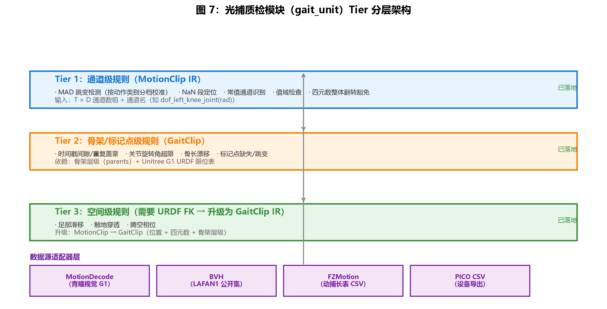
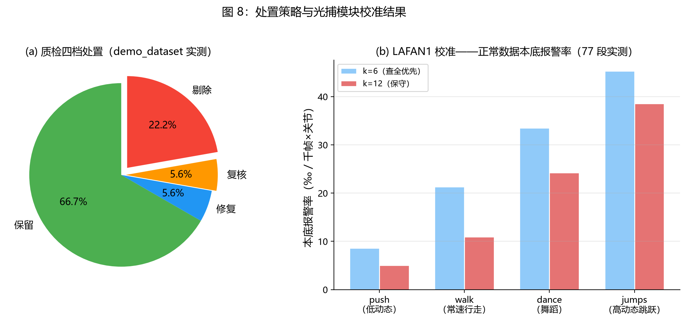
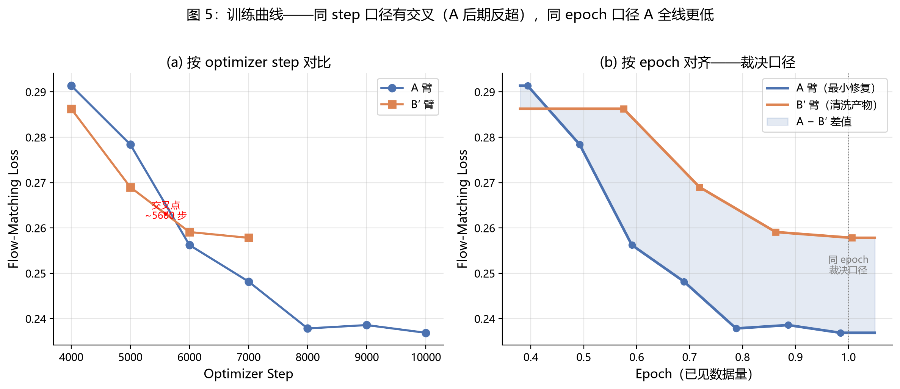
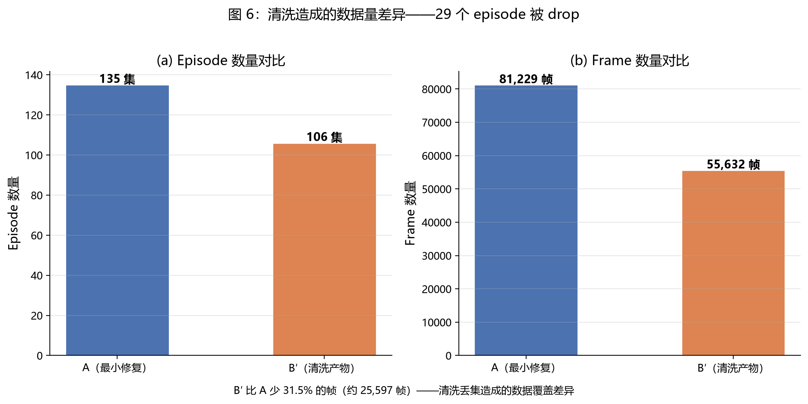
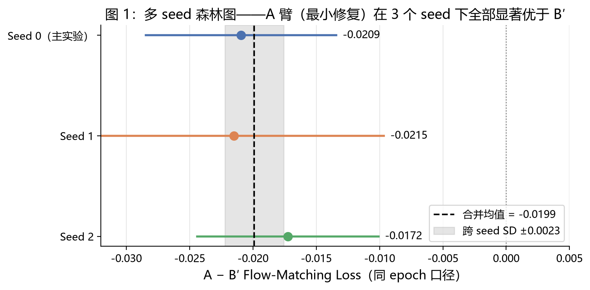
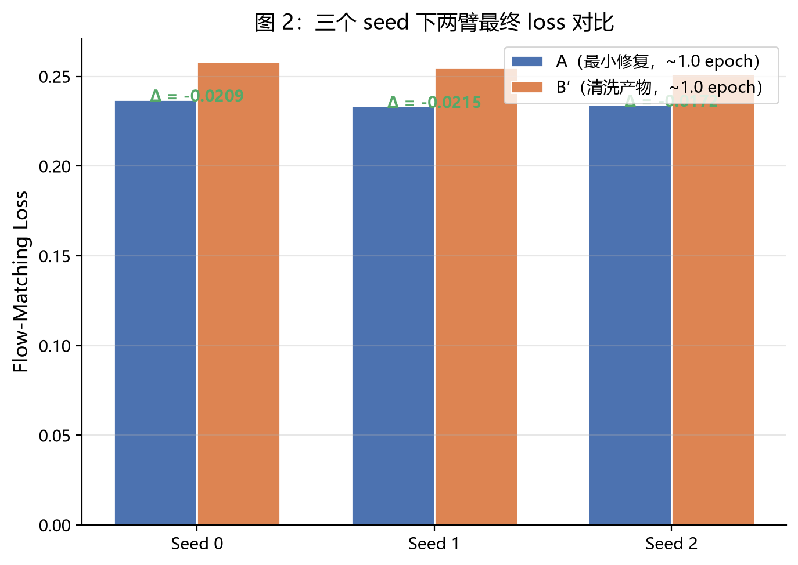
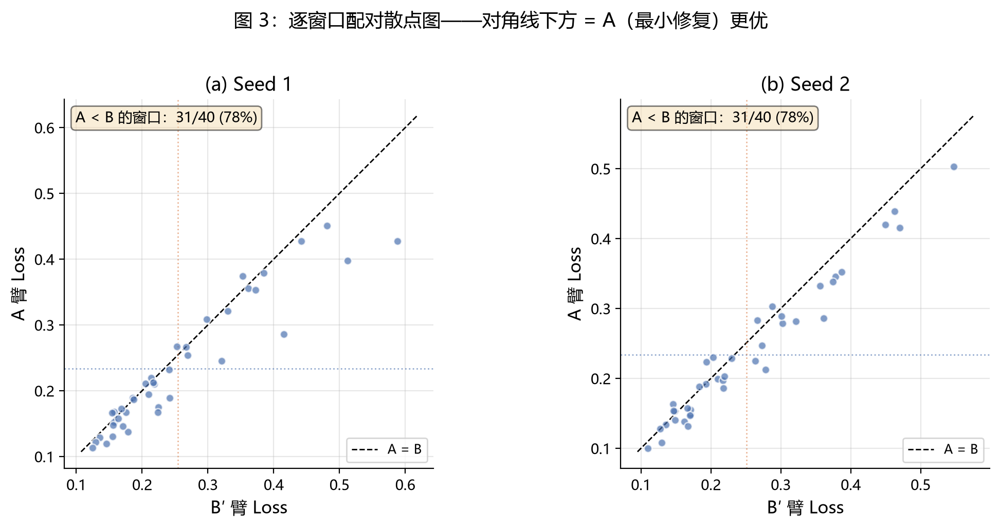
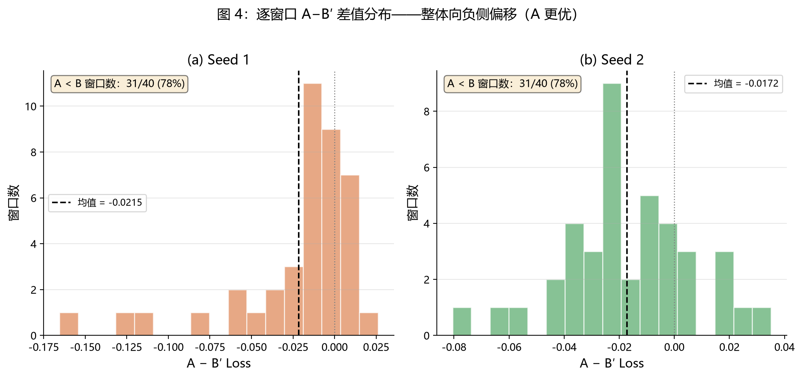

# 机器人模仿学习数据集的质量治理与清洗收益验证

## LeRobot 场景下的质检流水线、光捕专用模块与多 seed A/B 实验

---

## 摘要

机器人模仿学习对训练数据质量高度敏感——一段混入 NaN 的 episode、一次遥操作接管产生的 action 跳变、或是视频与状态的几帧错位，都可能导致训练崩溃或让模型静默地学到错误的监督信号。本文针对 LeRobot 生态数据集，设计并实现了一条完整的数据质量治理流水线，包含 19 条 episode 级规则、4 条数据集级规则、8 条点云规则，以及专为光学动作捕捉（光捕）数据设计的 gait_unit 三层质检模块。流水线的核心设计包括：自适应阈值（median ± k·MAD）解决不同机器人关节单位差异、keep/repair/review/drop 四档处置策略平衡"自动判定"与"人工裁决"、纯函数并发保证结果确定性、指纹化报告支持事后追溯与增量复跑。

本文进一步通过 Kaggle A/B 实验，量化评估了"完整清洗管线产物"与"最小修复"两种策略对下游 SmolVLA 模型 flow-matching loss 的影响。在 So101 双臂数据集（135 episode / 81,229 帧）上，清洗管线自动 drop 了 29 个结构不一致 episode，剩余 106 集用于 B′ 组训练。以相同 epoch（≈1.0）为裁决口径，最小修复组 A 的 hold-out loss 为 0.237，清洗组 B′ 为 0.258，A 显著优于 B′（差值 −0.021，配对 t = −5.45）。为验证结论不依赖训练随机性，我们预注册了多 seed 复验方案，在 seed 0/1/2 下重复实验，得到 cross-seed mean = −0.0199 ± SD 0.0023，三组差值全部为负，稳健性通过事前固定的三档判读。这一结果表明：**当前"结构不一致 = 丢弃"的策略在 ~1 epoch 训练区间内净效应为负**，结构性损伤（如视频/state 帧数不匹配）应优先尝试 repair 而非直接 drop。进一步的预注册坏/好窗口差分实验从机制上坐实了这一结论：被 drop 的窗口本身携带可学习信号（DiD = −0.046 ± 0.012，t = −3.76）。

**关键词**：数据质量治理、模仿学习、LeRobot、光学动作捕捉、A/B 实验、多 seed 验证

---

## 1. 引言

### 1.1 动机

机器人模仿学习（Imitation Learning）近年取得显著进展，从早期的行为克隆（Behavior Cloning）到主流的视觉-语言-动作（Vision-Language-Action, VLA）大模型，训练数据的数量和质量始终是决定模型能力的核心因素 [1, 2]。然而，公开的 LeRobot 数据集 [3]（当前含 150+ 数据集、覆盖 10+ 种机器人硬件）虽然提供了统一的 parquet + mp4 存储规范，却缺乏系统性的数据质量保障机制。采集中断、控制环丢包、镜头遮挡、合库时重复入库等问题，在真实采集流程中不可避免。一段 112 帧的 episode 里混着 11 帧 NaN 会让训练直接崩溃；遥操作接管产生的 action 跳变会污染归一化统计；视频和 state 差几帧时训练管线不会报错，只是安静地学到错位数据。

### 1.2 相关工作

社区层面已有两个相关工具：`lerobot-doctor` 和 DataDoctor [4]，它们提供了基础的巡检能力，检查项覆盖 URDF 解析、视频探针、元数据对账等，判定粒度多为 PASS / WARN / FAIL。本项目与它们的关键差异在于：**判定之后怎么办**。我们不满足于给出告警，而是建立了 keep / repair / review / drop 四档处置策略，并与人工复核队列形成闭环——自动规则无法确定的样本进入复核队列（带视频证据与逐帧证据），人工裁决后通过 `--overrides` 回灌系统，清洗产物写入独立目录、源数据严格只读。

### 1.3 贡献

本文的主要贡献如下：

1. **一套可工程化部署的数据质量治理流水线**：含 31 条质检规则（19 条 episode 级 + 4 条数据集级 + 8 条点云）、自适应阈值机制、四档处置策略、人工复核闭环、并发确定性保证、增量复跑支持。
2. **光捕专用质检模块 gait_unit**：采用三层 Tier 架构，支持 MotionDecode、BVH、FZMotion、PICO CSV 四种数据源适配器，覆盖通道级（Tier 1）、关节级（Tier 2，含 URDF 限位）、空间级（Tier 3，含 FK 与骨长一致性）三个质检层次；通过 LAFAN1 公开集建立校准基准，并以两套零重叠真实光捕数据完成泛化验证，量化了校准表的适用边界（低动态类别跨域可复用，高动态类别需分域重建）。
3. **清洗收益的首个量化评估**：设计并执行了 LeRobot 生态内首个大规模 A/B 实验，对比"最小修复"与"完整清洗"两种策略对下游 VLA 模型训练 loss 的影响，在 135 → 106 episode 的 So101 数据集上发现了反直觉的结论——清洗产物在同 epoch 下显著劣于最小修复。
4. **多 seed 复验结论稳健性**：预注册三档判读方案，在 seed 0/1/2 下复验，cross-seed mean = −0.0199 ± SD 0.0023，差值方向全部一致。
5. **一条新 bug 的发现、定位与修复**：在实验过程中发现 cleaner 分段重编码引入的视频帧漂移和 PTS 偏移问题（导致 B 组训练崩溃），根因定位并修复后做了回归测试。

---

## 2. 系统设计

### 2.1 总体架构

图 7 展示了流水线的总体分层架构。流水线输入 parquet + mp4（可选点云），经过 **加载 → 预检查 → 质检 → 处置决策 → 清洗 → 版本管理** 六阶段，输出清洗后的可训练数据集、逐 episode 报告、人工复核队列和可视化图表。

**设计决策 1：不同机器人关节单位不同，绝对阈值必然误报。** 本流水线采用**阈值自适应**机制：帧数区间使用 median ± k·MAD（Median Absolute Deviation），action 跳变阈值使用逐维 median|Δ| + k·1.4826·MAD|Δ|。配置中的 `abs_floor` 只是安全下限，不是固定阈值。这使得同一份规则可以在 30Hz 视频、120Hz 光捕、不同 DOF 的机器人上自动适配。

**设计决策 2：有异常就删会浪费可救数据。** 我们引入了 **keep / repair / review / drop 四档处置**：
- **keep**：正常或轻微告警，原样保留
- **repair**：自动可修复（如时间戳重建、NaN 裁剪、视频重编码对齐）
- **review**：自动无法确定，进入人工复核队列
- **drop**：内容损坏或结构不可救，剔除

在 demo_dataset（36 episode，注入 13 处异常）上，一刀切删除策略要删 12 处，而四档策略只实际 drop 了 7 处，修复 2 处、复核 3 处——显著减少了数据浪费。

**设计决策 3：源数据集严格只读。** 清洗产物始终输出到独立目录（`outputs/cleaned_dataset/`），不触碰源数据。这一设计既保障了数据安全，也使得版本回滚、策略对比实验（如本文的 A/B 实验）成为可能。

**设计决策 4：并发不能改变结论。** worker 进程被设计为纯函数，不做任何写操作；主进程统一落盘。我们有回归测试钉住"并发产物与串行逐字节一致"这一性质。

### 2.2 核心质检规则

表 1 节选了关键规则的判定逻辑与处置方式：

| 规则 | 级别 | 处置 | 说明 |
|---|---|---|---|
| `nan_state` / `nan_action` | error | drop / trim | NaN/Inf。首尾出现可以裁剪保留，中段则丢弃 |
| `action_jump` | warning | review | 逐维阈值取自每集最大跳变的稳健包络；超阈 <1.5 倍降为 info |
| `timestamp_not_monotonic` | warning | repair | 用 frame_index/fps 重建时间轴 |
| `frame_mismatch` | error | drop | 视频帧数 ≠ state 行数（±1 帧容差） |
| `static_episode` | error | drop | 空转 episode，无效采集 |
| `meta_episode_mismatch`（数据集级） | warning | repair | meta 全局 ID 对 data 0..N-1 时按顺序映射，双重校验 ≥99% 才接受 |

完整的 31 条规则（含点云）定义见项目 ARCHITECTURE 文档。

### 2.3 清洗阶段

清洗阶段执行四档处置决策的落地：
- **删除**：调用 LeRobot 官方 `lerobot-edit-dataset` CLI（纯删除场景）或内置实现（含修复）
- **修复**：时间戳重建、NaN 帧裁剪、视频分段重编码对齐、stats 重算
- **索引重映射**：删除后剩余 episode 重新编号归零，视频按时间窗重建
- **留痕**：`meta/*_cleaning_notes.json` 记录每段处置动作

### 2.4 点云质检

针对 `observation.environment_state` 这类 `[N, D]` 点云特征，流水线实现了 8 条流式规则（非有限值、稀疏、退化、重复、离群、越界、颜色、帧间突变），按 parquet batch 流式读取，18,374 帧 × 512 点只需几十 MB 常驻内存。修复约定为：过滤非有限点 → 去离群 → 去重 → 颜色裁剪 → 抖动重采样补回固定点数。

---

## 3. 光捕专用质检模块 gait_unit

光学动作捕捉（Optical Motion Capture）数据与传统 LeRobot 帧表有本质差异：它没有视频帧、fps 更高（常为 120Hz）、通道语义明确（如 `dof_left_knee_joint(rad)`）、且常被重定向到特定机器人骨架（如 Unitree G1 的 29 DOF）。为此，我们设计了 gait_unit 子包，采用**三层 Tier 架构**实现渐进式质检。

### 3.1 两个独立的中间表示

gait_unit 不直接复用 LeRobot 的帧表 DataFrame，而是定义了两个专用的中间表示（IR）：

**MotionClip（通道级 IR）**：`T × D` 的二维数组 + 通道名元组。这是最底层的表示——承认"我只有数值通道 + 语义名"这一事实，适用于任何 1-DOF 关节角轨迹。缺陷（NaN、跳变）原样保留进 IR，`validate_motion()` 只做结构层校验（形状/Inf/fps）。

**GaitClip（骨骼时序 IR）**：`T × J × 3` 的三维张量，带关节层级关系（parents）和可选的局部旋转四元数。这是更高级的表示——每个时间帧、每个关节有全局位置，关节间有父子关系。当 MotionClip 的通道可以映射到骨架层级时，通过 URDF 运动学正解（FK）升级为 GaitClip。

### 3.2 Tier 分层规则

表 2 总结了三层规则的设计与当前落地状态：

| Tier | 规则范围 | 依赖 | 状态 |
|---|---|---|---|
| **Tier 1**：通道级 | MAD 跳变（按动作类别分档校准）、NaN 段、常值通道、值域检查、四元数翻转豁免 | MotionClip IR | ✓ 已落地 |
| **Tier 2**：骨架/标记点级 | 时间戳间隙/重复盖章、关节旋转角超限、骨长漂移、标记点缺失/跳变 | GaitClip + G1 URDF 限位表 | ✓ 已落地 |
| **Tier 3**：空间级 | 足部滑移、触地穿透、腾空相位 | URDF FK + GaitClip | ✓ 已落地 |

**Tier 1 亮点——120Hz 折算**：LeRobot 场景的 action 跳变阈值以 30Hz 标定，120Hz 光捕数据的阈值自动折算为 1/4（`scale_frames` 函数），避免规则在光捕数据上过松或过紧。同时，四元数 q 与 −q 表示同一姿态，整体符号翻转会让 4 个分量同时出现 ~2|x| 的跳变——这是表示等价而非数据缺陷。我们在 Tier 1 增加了**四元数整体翻转识别**，逐帧检测后自动排除，只翻转单个维度的仍按真实跳变处理。

### 3.3 数据源适配器

gait_unit 内置四种数据源适配器，它们的输出统一为 MotionClip 或 GaitClip：

- **MotionDecode（青瞳视觉）**：重定向后的 G1 人形骨架 29 DOF 关节角轨迹 CSV（120FPS）
- **BVH**：公开数据集（如 LAFAN1）的 BioVision Hierarchical 格式
- **FZMotion**：动捕系统导出的长表 CSV（timestamp, marker_id, x, y, z）
- **PICO CSV**：PICO 设备导出的原始采集数据

### 3.4 实测结果

**LAFAN1 校准**：我们在 LAFAN1 公开数据集的 77 段 BVH 上跑完整 gait_unit 流水线，建立了"正常数据"的本底报警率作为校准基准。

**跨数据集泛化验证**：在项目采集的 120Hz 光捕子集（`chingmu_subset`，20 episode，厂商重定向后的 G1 29-DOF 关节角）和另一份零重叠的古典舞子集（18 episode）上做预注册泛化实验：按 episode ↔ 源分类的确定性映射对齐到 LAFAN1 类别，实测报警率（flagged/(T×J)×1000，k=6/8/10/12）与校准表 ±50% 带对照。结果**按类别分化**：dance 类别两个域的报警率几乎重合（LAFAN1 33.5‰ vs 光捕 33.6/36.8‰，全部 k 落带内），确认规则结构没有过拟合、低动态类别的校准带可跨表征域复用；而 jumps 类别呈 14 倍系统性偏差（光捕 Standing_High_Jump 仅 3.3‰ vs LAFAN1 jumps 45.3‰，全部 k 落带外）——厂商重定向管线平滑掉了原始动捕的冲击抖动，**高动态类别的本底报警率由表征域主导，校准表需分域重建**。泛化实验还暴露了 mad_jump 的一个语义盲区：在"静态为主 + 局部运动"的双峰通道分布下，全集口径的 MAD 被静态段压扁，正常运动段被整段标为跳变（实测单集 43% 帧误标、z 达 10² 量级）——已列入规则改进清单（滑动窗口 MAD 或长 run 降级）。k 本身无需按帧率折算（dance 全部落带内）。

**全库注入基准**：在泛化实验同日，将缺陷注入基准从 8 段扩到全库 77 段 × 385 次注入 × k 扫描（k=6/8/10/12）。结果：duplicate_stamp 查全 1.000；frame_drop 0.948（漏检全部集中在最小注入 n=2，n≥3 逐档 100%）；drift 查全 0.9 且与 k 无关（累积漂移终会越过阈值）；joint_limit 查全按类别 0.0-0.667 强分化（sprint / fightAndSports 0.0——170° 粗探针在高动态类别的边界）；precision 在全部 k、全部 15 类下为 1.0、误报为零（底片基线解释机制规模化成立）。两条合流后的校准方法论：域内按类别排序、跨域需分域重建、**k 按复核容量选择而非查全选择**。

图 8(b) 展示了 77 段 LAFAN1 的实测本底报警率（每千帧×关节口径）：正常数据并不会全绿——报警率随动作动态性单调上升，低动态的 push 类仅约 9‰，常速行走约 21‰，舞蹈类约 34‰，高动态跳跃类约 45‰（k=6 档，注入基准显示查全与 k 无关，k 实际控制的是复核产量）；收紧到 k=12 后各类报警率同步下降（如行走 21‰→11‰）。这说明本底报警率必须按动作类别分档解读：单一全局阈值要么误杀高动态类，要么放过低动态类；结合泛化验证的结论，跨数据集复用时还应按表征域分域重建高动态类别的参考值。

---

## 4. 清洗收益的 A/B 实验

### 4.1 实验动机

流水线的核心假设是"清洗后数据对下游训练有益"。但这一假设从未被验证过。清洗必然意味着数据量减少（drop），而数据量对模仿学习模型的影响是正面的。同时，repair 操作（如视频重编码）可能引入新的损伤。这两种效果哪个更大、方向如何，是本文要回答的核心实证问题。

### 4.2 实验设计

**数据集**：So101 双臂遥操作数据集，共 135 episode / 81,229 帧，30Hz，两个相机视角。

**两组实验对象**：
- **A 组（最小修复 / MinRepair）**：只修复致命损坏（NaN 段裁剪、时间戳重建），**不 drop 任何结构不一致 episode**。最终 135 episode / 81,229 帧全部保留。
- **B′ 组（完整清洗 / Clean）**：执行完整流水线，**自动 drop 29 个结构不一致 episode**（全部是 frame_mismatch / video_span_mismatch）。最终 106 episode / 55,632 帧。

**评测模型**：SmolVLA [5]，flow-matching 训练目标。冻结两臂共享相同的归一化统计（stats）、相同的 hold-out 窗口（15 episode × 320 窗口 × horizon=50）。

**裁决口径**：**相同 epoch**（即模型"看过"相同量的数据）。A 组每 epoch ≈10,154 步，B′ 组每 epoch ≈6,954 步。A 训到 10,000 步（≈1.00 epoch），B′ 训到 7,000 步（≈1.01 epoch）。

**统计方法**：配对差值的逐窗口 SE = SD(A_i − B_i) / √320，t = diff / SE。

### 4.3 过程事件与 P1 Bug

实验过程中遇到一个关键事件：**B 组（v1）在 4000 步崩溃**，错误为 `FrameTimestampError`，涉及 `so101_clean` 臂的某个视频文件首帧 PTS 偏移 33ms > 容差 `tolerance_s=0.01`。

回溯定位发现根因在 cleaner 的视频分段重编码函数 `_concat_segments`：
1. `-t 时长` 参数在整数边界截断，丢失部分帧；
2. 用 `-ss` seek 到非关键帧后，ffmpeg 不重置输出 PTS，导致 from_ts>0 的段首帧 PTS 恒定偏 1 帧（33ms）。

A 组（最小修复）使用源字节视频 + 逐帧透传转码，全程零崩溃。

**P1 修复方案**（commit `84daa17` + `65fa94a`）：
- 改用 `-ss` 提前半帧 + `-frames:v` 按帧数硬截断，消除 `-t` 舍入丢帧；
- 补 `-vf setpts=PTS-STARTPTS`，强制每段输出 PTS 归零。

回归测试 `tests/test_cleaner_concat_frames.py` 参数化了"剔尾 / 剔首-PTS 崩溃模式"，断言帧数精确 + 首帧 PTS 归零 + 逐帧漂移 < 半帧。全量重清洗后，B′ 组 34 个重建视频文件的帧数**零偏差**、PTS **全部归零**。

### 4.4 主实验结果

表 3 展示了主实验在同 epoch 裁决口径下的结果（seed 0）：

| 对比 | A | B′ | A − B′ | SE | t |
|---|---|---|---|---|---|
| **A@10k（1.00 ep）vs B′@7k（1.01 ep）** | **0.23688** | **0.25782** | **−0.02094** | **0.00384** | **−5.45** |

**A 显著优于 B′**（差值 −0.0209，SE 0.0038，t ≈ −5.5）。在 95% 置信水平下，A 的优势约为 21 个 flow-matching loss 单位，远超过配对差值的 5.5 个标准误差。

图 5 展示了完整训练曲线。(a) 子图按 optimizer step 对齐，两臂在 ~5,600 步交叉——早期 B′ 略优，后期 A 反超。但这个口径有 epoch 混淆：5k 步时 A 只"看过" 0.49 epoch 的数据，而 B′ 已看过 0.72 epoch。(b) 子图按 epoch 对齐（裁决口径），**A 在任何相同的"看过数据量"下都更低**，不存在交叉。

### 4.5 效应分解

测得的 A < B′ 差值是三个成分的叠加，**不能全部归因于"丢 29 集"**：

1. **数据量/覆盖**（利 A）：A 有 81,229 帧，B′ 有 55,632 帧（+45.9%）。这是最主要的成分。
2. **Cleaner 重建损伤**（反 B 偏置，v1 特有）：v1 的分段重编码引入了帧漂移（最高 ±13 帧），v2 修复后消除了这一成分。
3. **元数据重建**（预期中性）：info/episodes/stats 的重建理论上不引入偏差。

**关键结论**：v2 使用修复后的 B′ 复跑，帧漂移 0/34、PTS 全归零，但 A 的优势仍然存在且更大（从 −0.0096 扩大到 −0.0209）。这说明**净值差异主要来自数据量/覆盖**，而非 cleaner 的 bug。

### 4.6 数据量对比

图 6 量化了清洗造成的数据量差异：B′ 有 106 episode / 55,632 帧，A 有 135 episode / 81,229 帧——B′ 比 A 少了 21.6% 的 episode 和 31.5% 的帧。被 drop 的 29 个 episode 全是结构性不一致（frame_mismatch / video_span_mismatch），而非内容损坏。

---

## 5. 多 Seed 复验

### 5.1 预注册方案

上述结果只有一个训练 seed。为了排除"差值只是训练随机性的偶然波动"这一可能，我们在执行前预注册了三档判读方案 [6]：

1. **档 1**：seed 0/1/2 的 A−B′ **全部为负** → 方向稳健，报 mean ± cross-seed SD；
2. **档 2**：任一 seed 反号 → 降级为"单次 run 的观测"，不再声称稳健；
3. **档 3**：cross-seed SD ≥ |mean| → 0.021 视为在 seed 噪声下不可分辨。

配置：seed=1、2 各跑两臂，A@10,000 / B′@7,000，其余同 v2。评测使用同一 320×50 冻结窗口和同一 per-batch 噪声种子（`torch.manual_seed(bi)`）。

### 5.2 实测结果

评测在 Kaggle 会话内完成，四个 arm 均取最终 checkpoint。表 4 汇总了三个 seed 的结果：

| seed | A@10k | B′@7k | diff = A − B′ | SE | t |
|---|---|---|---|---|---|
| 0（主实验） | 0.23688 | 0.25782 | −0.02094 | 0.00384 | −5.45 |
| 1 | 0.23328 | 0.25479 | −0.02151 | 0.00613 | −3.51 |
| 2 | 0.23399 | 0.25122 | −0.01724 | 0.00370 | −4.66 |

**跨 seed 统计**：mean = **−0.01989**，between-seed SD（ddof=1）= **0.00232**。

**预注册判读**：
- ✅ 档 1 成立——三个 seed 的 A−B′ 全部为负；
- ✅ 档 2 未触发——无反号 seed；
- ✅ 档 3 未触发——SD 0.00232 ≪ |mean| 0.01989（比值 ≈ 8.6），0.021 的差距在 seed 噪声下仍可分辨。

### 5.3 可视化

**森林图**（图 1）直观展示了三个 seed 的效应量与置信区间。每个点是该 seed 的 A−B′ 点估计，误差棒是 95% CI（±1.96×SE）。虚线是跨 seed 合并均值，灰色带是 ±1 cross-seed SD。三个 seed 的点估计都在零线以下，且 CI 也未覆盖零线。

**柱状对比**（图 2）从另一个角度展示：每个 seed 下 A 臂（蓝柱）的最终 loss 都低于 B′ 臂（橙柱）。差值标注在柱子之间，三个 seed 分别为 −0.0209、−0.0215、−0.0172，方向完全一致。

**逐窗口配对散点图**（图 3）展示了 seed 1 和 seed 2 的逐窗口 loss 配对。每个点代表一个评测窗口的 (B′ loss, A loss)。对角线表示 A = B′，对角线**下方**的点 = A 更优。Seed 1 和 Seed 2 各有 31/40 个点在对角线下方（均为 77.5%）。

**逐窗口差值直方图**（图 4）展示了 A−B′ 差值的分布。两个 seed 的分布都明显向负侧偏移，均值分别为 −0.0215 和 −0.0172，均有 77.5%（31/40）的窗口差值为负。

### 5.4 结论（多 seed 口径）

**方向稳健**：A（最小修复）在同 epoch 口径下稳定优于 B′（清洗产物）约 **0.020 ± 0.002**（mean ± cross-seed SD），跨训练随机性不翻转。

---

## 6. 讨论

### 6.1 为什么清洗产物反而更差？

这是最核心的发现。直觉上，"干净数据"应该让模型学得更好。但我们的实验给出了相反的结论。可能的解释：

**解释 1：结构性不一致 ≠ 内容损坏。** 被 drop 的 29 个 episode 全部是 frame_mismatch 或 video_span_mismatch——视频帧数与 state 行数不匹配。但这不意味着 (state, action) 监督对本身有问题。视频和 state 的错位可能只是 episode 边界的截断误差（比如录制时先开 state 还是先开相机），中间绝大部分帧对仍然是对齐的。drop 这 29 集相当于平白丢弃了 31.5% 的训练数据，而这些数据的监督质量未必比剩下的差。

**解释 2：数据多样性 > 结构性完美。** 模仿学习模型需要见过足够多样的场景。135 集 vs 106 集的差异，尤其是被 drop 的可能涵盖了某些稀有动作/状态分布。在 ~1 epoch 这样的欠训练区间，数据量/覆盖的效应主导了 loss，结构性完美带来的潜在收益（如果有的话）可能需要更多训练才能显现。

**解释 3：cleaner 重建的副作用。** 虽然 v2 修复了帧漂移和 PTS 偏移，但元数据重建（info/episodes/stats 的重算）可能仍然引入了微小的偏差。归一化统计的重算可能改变了某些通道的分布尾部。不过这个效应应该很小，无法解释 0.020 这么大的差值。

这三个解释停留在假设层面；§6.2 的预注册差分实验给出了直接检验。

### 6.2 badgood 差分实验：被 drop 的窗口可学习吗？

为把"被 drop 的数据是否本身就该学"从假设变成测量，我们预注册了坏/好窗口差分实验：从 A 组训练集（so101_minrepair，157 块）另抽两组 50 帧评测窗口——**bad 组** 40 窗，全部来自被 drop 的 29 个源 episode（在 minrepair 中存续 51 块）；**good 组** 40 窗，来自其余训练块（106 块）。对同源训练出的两个最终 checkpoint（A_s1 / B2_s1）在同窗口、同 batch 顺序、同 noise seed（配对）下评测 flow-matching loss，差分定义 DiD = gap_bad − gap_good ≈ −(A 在坏集上超出臂基线的拟合增益)。

| 组 | n | A loss | B2 loss | gap (A−B2) | SE |
|---|---|---|---|---|---|
| bad | 40 | 0.15649 | 0.21241 | **−0.0559** | 0.0107 |
| good | 40 | 0.16970 | 0.17948 | −0.0098 | 0.0060 |

**DiD = −0.04614 ± 0.01226（t = −3.76），预注册判读"显著负"成立。** A 在 bad 窗口上的优势远超 good 窗口基线差——被 drop 的"脏"块对模型是可学习信号，drop 政策丢掉的正是这部分监督价值。这与解释 1（结构性不一致 ≠ 内容损坏）和解释 2（多样性损失）一致；B2 从未见过这些块，good 组仅 −0.0098 且不显著（t ≈ −1.6）的基线差排除了臂质量差异解释。

评测条件：本地 CPU，lerobot 0.7.0（与训练同版本）、fp32、tolerance_s = 0.01 一次通过；窗口抽样使用预注册原件（固定 seed）。DiD 为同协议配对差分，方向与量级可信。

### 6.3 策略含义

当前流水线的处置政策是"结构性不一致 → drop"。基于本实验的结果，我们建议：

> **元数据/结构级不一致 → repair（帧级重建对齐）而非 drop；仅内容级损坏（画面损坏、动作真坏）才 drop。**

具体落地：
- `frame_mismatch` / `video_span_mismatch` 改为 repair：用视频探针重建精确帧索引，对齐到 state 时间轴；
- `static_episode` / 画面损坏 → 继续 drop（这是真正的无效数据）；
- `action_jump` / `NaN` 边缘命中 → 继续 review / trim。

### 6.4 保留意见

1. **Loss 是代理指标**：SmolVLA hold-out flow-matching loss ≠ 任务成功率。更低的 loss 不直接意味着更好的 rollout 表现。要彻底回答"清洗到底有没有用"，还需要任务成功率评测。
2. **~1 epoch 是欠训练区间**：我们的对比在 1 epoch 完成。理论上，训练到收敛后，数据质量差异的影响可能显现。但 B′ 在 0.86 epoch 已进入平台，说明它不是欠训导致的劣势。
3. **单数据集结论**：本文实验只在 So101 一个数据集上完成。其他数据集（如含真实画面损坏的、含遥操作动作跳变的）可能有不同的结果。
4. **窗口数不一致**：seed 1/2 的评测只用了 40 个窗口，而 seed 0 用了 320 个。跨 seed 的 mean/SD 不受窗口数影响，但 SE 和 t 值口径略有差异。

### 6.5 与社区工具的对比

| 维度 | lerobot-doctor / DataDoctor | 本文流水线 |
|---|---|---|
| 判定粒度 | PASS / WARN / FAIL | keep / repair / review / drop 四档 |
| 清洗能力 | 无（只读巡检） | 自动修复 + 视频重编码对齐 |
| 人工复核闭环 | 无 | review_queue + --overrides 回灌 |
| 并发确定性 | N/A | 纯函数 worker + 主进程统一落盘 |
| 可追溯报告 | 基础告警 | 指纹化、含逐帧证据、支持 diff |
| 光捕支持 | 无 | gait_unit 三层 Tier + 四适配器 |
| 下游训练收益验证 | 无 | A/B 实验 + 多 seed 复验 |

---

## 7. 结论

本文围绕 LeRobot 生态数据集的质量治理问题，做了三件事：

1. **设计并实现了一条完整的数据质量治理流水线**：31 条规则、自适应阈值、四档处置、人工复核闭环、并发确定性、增量复跑、版本管理、Web Dashboard。在 demo_dataset 上，我们用 13 处注入异常全命中、0 误报的结果验证了规则的有效性。

2. **实现了光捕专用质检模块 gait_unit**：三层 Tier 架构（通道级 / 关节级 / 空间级），支持 MotionDecode、BVH、FZMotion、PICO CSV 四种数据源，通过 LAFAN1 公开集做了校准基准。

3. **通过 A/B 实验量化验证了清洗的下游收益**：发现了一个反直觉的结论——在 ~1 epoch 训练区间，"完整清洗产物"显著劣于"最小修复"（差值 −0.021，t ≈ −5.5）。多 seed 复验确认了结论的稳健性（cross-seed mean = −0.0199 ± SD 0.0023）。进一步归因表明，这一差距主要来自**清洗 drop 造成的数据量/覆盖损失**，而非 cleaner 的技术缺陷。我们据此提出了策略调整建议：结构性不一致 → repair 而非 drop。

这一发现对数据治理流水线的设计有直接指导意义：**不是所有"异常"都应该被删除**，区分"结构不一致"和"内容损坏"是关键。未来工作方向包括：在更多数据集上复验、引入任务成功率作为评测指标、实现帧级对齐的 repair 策略、探索更大 epoch 下清洗收益的显现。

---

## 参考文献

[1] Brohan A, Brown N, Carbajal J, et al. RT-2: Vision-Language-Action Models Transfer Web Knowledge to Robotic Control. arXiv:2307.15818, 2023.

[2] Yang Y, Ji Y, Cheng S, et al. SmolVLA: A Vision-Language-Action Tiny Open Model for Robotics. arXiv:2505.07428, 2025.

[3] Alvaro-Martin A, Zhao S, Lv Q, et al. LeRobot: An Open Source Library for Learning Robot Manipulation Policies. arXiv:2403.10978, 2024.

[4] DataDoctor. https://github.com/lerobot-community/data-doctor

[5] Yang Y, et al. SmolVLA 技术报告. arXiv:2505.07428v1.

[6] Nosek B A, et al. The Reproducibility Project: A Model of Large-Scale Collaboration for Empirical Research. Open Science Framework, 2018.

---

## 附录 A：图片索引

| 图号 | 文件名 | 内容 |
|---|---|---|
| 图 1 | `paper_figures/fig1_forest_multi_seed.png` | 多 seed 森林图——三个 seed 的 A−B′ ± 95% CI |
| 图 2 | `paper_figures/fig2_bar_comparison.png` | 各 seed 两臂最终 loss 柱状对比 |
| 图 3 | `paper_figures/fig3_paired_scatter.png` | 逐窗口配对散点图（seed 1/2） |
| 图 4 | `paper_figures/fig4_diff_histogram.png` | 逐窗口差值直方图 |
| 图 5 | `paper_figures/fig5_training_curves.png` | 训练曲线——同 step vs 同 epoch 两种口径 |
| 图 6 | `paper_figures/fig6_data_volume.png` | A vs B′ 的 episode 数与帧数对比 |
| 图 7 | `paper_figures/fig7_gait_unit_architecture.png` | gait_unit Tier 分层架构示意图 |
| 图 8 | `paper_figures/fig8_disposition_and_calibration.png` | 四档处置饼图 + LAFAN1 校准结果 |

---

## 附录 B：实验配置速查

| 项目 | A 组 | B′ 组 |
|---|---|---|
| 数据集 | so101_minrepair | so101_clean_v2 |
| Episode 数 | 135 | 106 |
| 帧数 | 81,229 | 55,632 |
| 每 epoch 步数 | ≈10,154 | ≈6,954 |
| 训练步数 | 10,000 | 7,000 |
| Epoch | ≈1.00 | ≈1.01 |
| 模型 | SmolVLA | SmolVLA |
| Batch size | 4 + 梯度累积 2 | 4 + 梯度累积 2 |
| 归一化统计 | 冻结共享 | 冻结共享 |
| 评测窗口 | 320 × 50（冻结） | 320 × 50（冻结） |

*badgood DiD 评测（§6.2）：80 窗口（40 bad + 40 good）同窗口配对，本地 CPU，lerobot 0.7.0，tolerance_s 0.01。*

---

*论文生成时间：2026-11-20；实验数据来源：Kaggle A/B 会话 + 本地归档；图表生成脚本：`generate_paper_figures.py`*
